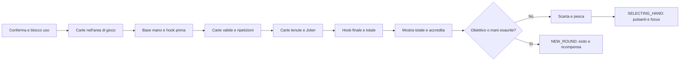

# Balatro — studio tecnico e applicazioni indipendenti a Manuscript

Data: 15 ottobre 2026. Versione studiata: **1.0.1o-FULL**, verificata nei sorgenti accessibili e nel menu. Questo documento descrive questa copia, non tutte le versioni di Balatro.

Il risultato principale è una sequenza causale leggibile: elemento che contribuisce, variazione del contatore, totale della mano, trasferimento al punteggio accumulato, nuova mano. Non dipende da un unico shader o da una generica animazione elastica. Il codice orchestra barriere temporali, trasformazioni continue e segnali sonori; non separa però completamente la presentazione dallo stato di gioco. Per Manuscript conviene estendere il modello di presentazione già esistente, mantenendo autorevole la logica Farkle.

## 1. Perimetro, identità e mappa dei moduli

Installazione letta: `S:/Hydra Games/Balatro/Balatro.exe`. SHA-256: `0d75fe164accf3312734d4b37ac98788dd15f0b8e4f9bb8b7f90c4e59de93f47`. REA identifica un PE x86-64. Il contenitore ZIP incorporato è leggibile senza aggiramenti: 304 voci, 47 Lua, 19 shader `.fs`. Lettura selettiva in memoria, nessuna decompilazione nativa e nessun trasferimento di sorgenti o asset commerciali nel repository.

Le citazioni Balatro sotto sono **membri dell'archivio e righe a base 1**, riproducibili sulla copia identificata. Le impronte dei membri sono in [source-identity.json](audits/balatro-study/source-identity.json). I percorsi Manuscript sono invece file reali del repository. Distinzioni: **statico** = verificato nel codice; **osservato** = visto nei fotogrammi; **proposta** = progetto originale, non implementato; **ignoto** = non misurato.

| Modulo Balatro | Responsabilità verificata |
|---|---|
| `main.lua:69-82,324-387` | Delta temporale, ciclo LÖVE, ridimensionamento Canvas |
| `game.lua:127-134,2449-2633,2732-2967` | Caricamento shader, clock, aggiornamenti, composizione finale |
| `engine/event.lua:5-195` | Eventi, interpolazioni di campi, code e barriere |
| `engine/moveable.lua:250-456` | Target e trasformazioni visibili, movimento, impulsi, pinch |
| `engine/sprite.lua:43-117,162-167` | Coordinate atlante, uniform e passaggi di disegno |
| `card.lua:1016,2291,4348-4553` | Edizioni, valutazione Joker e composizione visiva carte |
| `functions/state_events.lua:450-1068` | Conferma mano, valutazione, contributi e accredito |
| `functions/common_events.lua:362-578,779-925` | Attese, spostamento carte, HUD e popup di contributo |
| `functions/button_callbacks.lua:1941-2024` | Intensificazione del totale e fiamme del punteggio |
| `functions/misc_functions.lua:695-778` | Richieste audio, musica e ambienti collegati allo stato |
| `engine/sound_manager.lua:15-207` | Thread audio, sorgenti, voci e modulazione |

Letti anche `FX_STUDIO.md`, `FX_PROTOTYPES.md` e lo stato corrente descritto da `GAME_FEEL_INTEGRATION.md`. Il laboratorio non è più l'unico luogo con questi effetti: trasferimento dei dadi, conteggio e feedback sono già presenti in produzione. Le proposte non ripartono da zero.

## 2. Architettura degli eventi e delle animazioni

### Code e barriere

`Event` distingue immediate, before, after, condition ed ease. Before esegue il callback e mantiene la barriera per il ritardo; after attende prima di eseguire. Un callback non concluso rimane pendente. Il timer normalmente parte al primo trattamento eleggibile, non alla costruzione. Blocking e blockable sono due proprietà distinte: un evento cosmetico non blockable può superare una barriera; una barriera vale nella propria coda, non globalmente. Le cinque code sono attraversate con `pairs`: non esiste un ordine totale esplicito fra code (`engine/event.lua:48-102,109-195`).

Il manager usa una soglia di 1/60 s, ma non è un thread né un integratore a passo fisso con recupero: effettua un passaggio per update eleggibile. Anche un evento blocking appena completato può impedire i successivi nello stesso passaggio. Sommare i delay non basta per prevedere il tempo di parete.

Ease conserva un riferimento a un campo mutabile, acquisisce il valore iniziale quando parte e lo porta al target. Sono disponibili interpolazione lineare, curva quadratica sul tempo residuo ed elastica. Questo meccanismo può modificare direttamente campi di gioco, non soltanto copie grafiche. La pulizia delle code preserva gli eventi `no_delete`.

### Clock differenti

Il delta principale è smussato 80/20 e limitato a 0,1 s (`main.lua:69-82`). REAL è accumulo di quel delta, non lettura diretta del cronometro. TOTAL incorpora velocità di gioco e un'accelerazione durante HAND_PLAYED/NEW_ROUND: il termine cresce, superata una soglia aumenta la velocità, con limite superiore (`game.lua:2484-2509`). Pause e creazione durante pausa selezionano comportamenti differenti. REAL_SHADER si immobilizza con movimento ridotto; BACKGROUND ha una progressione separata.

Le animazioni sprite ricevono delta reale moltiplicato per velocità, il movimento riceve delta reale limitato a 0,05, gli oggetti ricevono delta gameplay moltiplicato per velocità (`game.lua:2612-2633`). Quindi non tutto accelera nello stesso modo.

### Movimento e impulsi

`Moveable` separa target T e trasformazione visibile VT: posizione con velocità smussata, limite e aggancio vicino al target; scala con hover/drag; rotazione influenzata anche dal movimento laterale (`engine/moveable.lua:405-456`). Coefficienti esponenziali derivano dal delta. Timbri per frame evitano aggiornamenti duplicati nelle gerarchie major/minor.

`juice_up` sovrappone un impulso oscillante di 0,4 unità REAL, con decadimento cubico della scala e quadratico della rotazione; un nuovo impulso sostituisce il precedente. Le frequenze matematiche corrispondono circa a 8,09 e 6,49 Hz, non sono misure video. Riduzione del movimento disabilita il juice. Pinch modifica larghezza/altezza verso zero o il target a velocità proporzionale alla dimensione (`250-275,434-443`).

La stanza combina deriva lenta, jiggle decadente e influenza smussata del cursore. Shake e rumble rispettano impostazioni dedicate (`common_events.lua:1127-1160`). Il conteggio può così muovere l'oggetto, il testo e leggermente l'ambiente nello stesso evento, senza che tutti condividano la medesima curva.

## 3. Shader e Canvas

L'analisi completa dei **19 file** è inclusa nella sezione 3A in fondo al documento. Comprende input, coordinate, tempo, matematica, chiamanti, composizione e costo statico. Due file sono solo vertex shader: non sono 19 effetti frammento equivalenti.

Distinzioni essenziali:

- `holo` e `hologram` sono effetti differenti: il secondo costruisce un alone con 82 campionamenti espliciti, il primo lavora principalmente in HSL con un campionamento.
- Il `time` comune dello sprite è un seed stabile derivato dall'identità; l'animazione del materiale arriva anche dal vec2 specifico. Confonderli descriverebbe erroneamente la dissolvenza come rumore in movimento.
- Il tilt delle carte modifica la coordinata omogenea dei vertici, non simula corpi tridimensionali.
- I passaggi delle edizioni ridisegnano l'atlante originale: non sono automaticamente una catena di filtri sul risultato del passaggio precedente.
- CRT è un passaggio sul Canvas finale; bloom e aberrazione possono portare il percorso a 52 fetch per frammento. Il costo effettivo non è stato profilato.

Al resize viene ricreato un Canvas leggibile a filtro lineare (`main.lua:324-387`); non emerge allocazione di un Canvas per ogni carta per frame. Scena, transizione e cursore entrano nella composizione; CRT disegna verso AA_CANVAS **se presente**, altrimenti verso lo schermo, e l'ulteriore presentazione AA è condizionale (`game.lua:2917-2967`). Il ramo Windows di attivazione AA esaminato è disabilitato. Il parametro glitch è zero nel chiamante normale.

## 4. Ricostruzione del conteggio: ordine e autorità dei dati

### Dal comando alla valutazione

`play_cards_from_highlighted` (`state_events.lua:450-538`) impedisce l'uso ordinario, conserva/interrompe il focus, ordina le carte selezionate per posizione e pianifica HAND_PLAYED. Decrementa le mani disponibili, inserisce un'attesa e trasferisce le carte nell'area di gioco. Seguono eventuale risposta del blind, `evaluate_play`, scarto e scelta dello stato successivo. L'inserimento annidato di eventi richiede di considerare la coda, non soltanto l'ordine testuale delle chiamate.

`evaluate_play` identifica la mano e le carte valide (`571-600`), includendo eccezioni quali Stone e Splash. Organizza l'evidenziazione, inizializza chips C e mult M dalla mano, esegue gli effetti Joker prima del conteggio ed eventuali variazioni di livello, quindi rilegge la base e applica la modifica del blind (`601-645`).

### Ordine dei contributi

| Fase | Operazioni e ordine | Evidenza statica |
|---|---|---|
| Carte che segnano | Per carta: lista di ripetizioni da sigillo/Joker; per ogni ripetizione valutazione della carta e Joker individuali | `648-701` |
| Contributi della carta | Chips additivi, mult additivo, denaro, extra (anche scambio/modifica), X mult, contributi dell'edizione | `702-780` |
| Carte in mano | Effetti held, ripetizioni quando pertinenti, mult additivo, X mult, denaro e messaggi | `784-875` |
| Joker e consumabili | Edizione additiva; effetto principale; interazioni degli altri Joker; moltiplicatore dell'edizione alla fine | `877-944` |
| Mazzo e conclusione | Hook finale del dorso, distruzioni e hook successivi; mano invalidata può portare C e M a zero | `946-1028,1068` |
| Totale | Intero inferiore di C × M; esposizione del totale, trasferimento al punteggio accumulato | `1029-1066` |

L'ordine non è intercambiabile: aggiungere mult prima di moltiplicarlo cambia il risultato. La sequenza esterna dei Joker segue la lista; alcune iterazioni interne usano `pairs`, senza un contratto generale di ordinamento. Non si può ridurre tutto a «somma dei bonus, poi tutti i moltiplicatori». Non sono stati esauriti tutti i rami specifici di ogni Joker.

I contributi sono tabelle restituite dalle valutazioni, con campi per chips, mult, X mult, dollari, edizione, messaggi e riferimenti alla carta. `card_eval_status_text` li traduce in feedback, mentre l'aritmetica procede nel percorso di valutazione. Un messaggio non implica necessariamente un incremento numerico.

### Quando il risultato è calcolato e quando appare

La maggior parte dell'aritmetica C/M viene eseguita sincronicamente in `evaluate_play`; il codice accoda gli aggiornamenti visivi intermedi. Quindi il calcolo può essere già avanzato mentre si vedono ancora i primi contributi. Tuttavia **non tutta l'autorità è separata dalla presentazione**: un ease modifica direttamente `G.GAME.chips` verso il totale accreditato. È scorretto descrivere l'intera sequenza come riproduzione puramente cosmetica di una transazione già conclusa.

`update_hand_text` (`common_events.lua:495-578`) assegna i valori intermedi ai campi HUD e aggiorna i testi; non interpola continuamente ogni addizione. Il totale della mano viene esposto dopo un evento after 0,4; con risultato positivo seguono un'attesa 0,8 e il segnale `chips2`. Due ease nominali da 0,5 trasferiscono punti al totale accumulato e riducono il totale della mano a zero, il primo non blocking e il secondo blocking (`state_events.lua:1029-1066`). Arrotondamento finale floor(C×M); l'ease usa valori interi per l'esposizione. Non è la prova che tutti i bonus intermedi siano arrotondati.

### Tempo configurato, non cronometro

| Segnale | Parametro nominale | Interpretazione |
|---|---:|---|
| Trasferimento singola carta | 0,1 | Before, `common_events.lua:386` |
| Evidenziazione carta | 0,1 | Before con suono, `426` |
| Popup chips | 0,75 | 0,6 × 1,25, `779-925` |
| Popup normale | 0,8125 | 0,65 × 1,25 |
| Popup extra/Joker ordinario | 0,9375 | 0,75 × 1,25, modificabile dall'effetto |
| Esposizione totale | after 0,4 | Non «durata totale del conteggio» |
| Attesa risultato positivo | 0,8 | Prima del trasferimento |
| Trasferimento contatori | 0,5 | Due ease, con blocking differente |
| Juice | 0,4 REAL | Altro dominio temporale |

Le prime righe usano normalmente TOTAL: velocità impostata, accelerazione di stato, code e frame cambiano il tempo osservato. Gli extra instant possono evitare l'attesa. Questi valori non vanno sommati come secondi reali garantiti.

### Osservazione diretta riproducibile

Due mani semplici giocate attraverso la UI, senza modifiche ai file. Nessun Joker equipaggiato nella sequenza campionata. Coppia di 9: base 10×2, contributi 9+9, totale 56. Coppia successiva di 7: (10+7+7)×2=48, accumulato 56→104. La seconda sequenza è conservata in 18 PNG e [timestamp JSON](audits/balatro-study/pair7-observations.json).

| Fotogramma | Tempo dalla richiesta di clic | Contenuto verificato visivamente |
|---|---:|---|
| `pair7-03.png` | 1,356 s | Carte giocate, 10×2, accumulato 56, comandi assenti |
| `pair7-06.png` | 2,606 s | Primo +7, 17×2 |
| `pair7-09.png` | 3,856 s | 24×2, accumulato ancora 56 |
| `pair7-12.png` | 5,084 s | Totale mano 48, chips/mult azzerati |
| `pair7-17.png` | 7,160 s | Accumulato 104, nuova mano 8/8, comandi ricomparsi |

I timestamp includono invio input, attese e cattura: sono istanti di osservazione, non durate esatte delle fasi o tempi input-to-photon. Il ritorno dei comandi è verificato entro l'ultimo campione, non esattamente a 7,160 s. Le immagini sono in `audits/balatro-study/`; non costituiscono una registrazione audio/video continua. La catena Joker è verificata staticamente, **non osservata in questa prova**.

## 5. Relazione fra effetti visivi e sonori

`card_eval_status_text` (`common_events.lua:779-925`) coordina testo vicino alla carta, impulso, jiggle e richiesta sonora nello stesso callback. Chips usa `chips1`, mult additivo `multhit1`, moltiplicativo `multhit2`, denaro `coin3`; edizione e messaggi hanno percorsi distinti. Il pitch ordinario dipende da un parametro percent progressivo: nella valutazione parte da 0,3 e cresce di 0,08. Non è una probabilità. In assenza del parametro alcuni chiamanti hanno variazione casuale di presentazione.

Il popup rimane nominalmente delay−0,2; l'impulso sulla carta è distinto dalla durata del popup. L'intensità del testo totale cresce con l'ordine logaritmico; fiamme e ambiente dipendono dal superamento del requisito del blind (`button_callbacks.lua:1941-2024`). Questo rende distinguibili addizione, moltiplicazione, esito e superamento della soglia, anziché usare lo stesso feedback per tutto.

`play_sound` invia codice, pitch, volume e contesto a un thread tramite canale (`misc_functions.lua:695-715`). Il manager riutilizza sorgenti libere o ne crea altre; musica normalmente streaming, effetti normalmente statici. Nessun limite fisso di voci è dimostrato (`sound_manager.lua:15-68`). Musica e ambienti seguono stato, proporzione punteggio/requisito e fiamme, con volume smussato (`misc_functions.lua:719-778`).

**Non misurato:** suono effettivamente udito, latenza del mixer, sincronismo audiovisivo, backlog del thread. La chiamata nello stesso callback dimostra coordinamento logico, non simultaneità acustica. Una verifica successiva richiede cattura loopback audio e video sincronizzati, marcando impulso visivo e onset audio.

## 6. Transizioni e recupero del controllo

`game.lua:3187-3207` rimuove i pulsanti durante HAND_PLAYED. Quando la sequenza segnala completamento, sceglie NEW_ROUND se raggiunto il blind o terminate le mani, altrimenti DRAW_TO_HAND. Quest'ultimo trasferisce le carte, applica hook di prima mano e pianifica SELECTING_HAND (`3208` e seguenti). SELECTING_HAND ricrea i comandi e ripristina il focus (`3010` e seguenti). Il controllo torna per transizione di stato, non perché ogni singola interpolazione abbia genericamente finito.

La valutazione del round introduce il pannello da fuori campo, attende una condizione sulla distanza target/visibile e accompagna l'arrivo con jiggle e suono (`game.lua:3302` e seguenti). Cashout disabilita il comando, fa uscire il pannello, riordina e passa a SHOP dopo gli eventi; accredita denaro, azzera il vecchio punteggio e accompagna l'operazione con feedback (`button_callbacks.lua:2912` e seguenti).

La continuità verificabile consiste nella sostituzione ordinata dei segnali: conferma, movimento delle carte, contributi, totale, accredito, nuova distribuzione, nuovi comandi. Le attese hanno un contenuto visivo, ma il codice non prova che siano sempre gradevoli: catene lunghe e ripetizioni possono diventare lente. L'accelerazione e la velocità configurabile sono risposte tecniche a questo costo. Non dimostrano da sole un giudizio di divertimento.

## 7. Confronto con Manuscript corrente

`src/features/farkle/presentation.lua:2-72` contiene già shelf, ledger, snapshot prima dell'azione, conteggio da 0,7 s, trasferimento da 0,52 s, conclusione da 0,45 s e completamento immediato. `presentation_view.lua:26-74` disegna ripiano, feedback e contributi. Controller collega azioni e presentazione; HUD e tray_view mostrano lo stato. `src/core/audio_manager.lua` dispone già di cue semantici. Il laboratorio offre modelli e shader originali in `experiments/fx_lab/`.

Le stime seguenti sono **relative di sviluppo**, non benchmark CPU/GPU o preventivi in ore: basso = pochi punti di presentazione; medio = contratto fra azione, contributi e feedback; alto = cambiamento architetturale non consigliato.

| Tecnica Balatro e problema risolto | Soluzione Manuscript e moduli | Costo / beneficio / rischio |
|---|---|---|
| Contributi seriali: rendere leggibile la causa del totale | Estendere ledger in presentation e contributions nella view | Medio; attribuzione chiara; rischio duplicare bonus se la view ricalcola |
| Impulso locale e target continuo: confermare senza teletrasporto | Conservare shelf esistente; solo accento sui gruppi confermati | Basso; continuità; rischio coprire i numeri con troppo movimento |
| Callback comune testo/suono: marcare attivazioni | Cue semantico controller→presentation/audio_manager una sola volta | Medio; medaglia comprensibile; rischio suoni/cariche duplicati |
| Barriere e velocità: ordinare catene | Timeline finita della singola transazione, senza manager generale | Medio; sequenza breve; rischio blocco input indebiti |
| Totale→accumulo→nuovo stato | Estendere conclusione esistente in presentation/hud | Basso-medio; chiusura del turno; distinguere provvisorio da assicurato |
| Materiali locali e dissolvenza | Riutilizzare shine/ink del laboratorio su medaglia o pagina | Basso-medio; identità libraria; rischi contrasto e alpha |
| Tilt omogeneo, shake stanza, CRT globale | Non adottare nel motore dei dadi | Beneficio non dimostrato; rischio picking, leggibilità e costo a schermo intero |
| Thread audio dedicato | Non riprodurre senza un collo di bottiglia misurato | Costo alto non giustificato dal numero attuale di cue |

## 8. Proposte originali di implementazione, non applicate

### Contratto comune: presentare una transazione già risolta

Estendere il modello corrente, senza introdurre un framework di eventi. Una transazione di presentazione conserva ID progressivo, causa, valori prima/dopo, identità dei dadi e gruppi già riconosciuti dalle regole, contributi effettivi e cue già emessi. Il controller risolve l'azione una volta; la vista non ricalcola punteggi, non consuma cariche e non cambia facce. Per bonus non disaggregabili dalle API attuali, mostrare il delta aggregato verificato, non inventare una spiegazione.

Clock cosmetico locale con delta non negativo, budget finito e skip. Cambio schermata annulla la presentazione; skip completa i contatori e sopprime i cue arretrati. Riduzione animazioni mostra immediatamente lo stato finale mantenendo un riepilogo leggibile. Nessun avanzamento del solver dipende da questa timeline.

### A. Conteggio progressivo Farkle

Riutilizzare `P.prepare`, `P.commit`, `P.display` e ledger. Il totale autorevole rimane quello delle regole; il valore mostrato percorre i contributi reali. Proposta iniziale: mantenere il budget corrente di 0,7 s, distribuendolo fra focus breve, contributi e assestamento. Per una fase normalizzata u usare una curva semplice `s(u)=3u²−2u³`, con estremi esatti; contatore intero e ultimo campione fissato al valore autorevole. Non sono costanti derivate da Balatro.

Non ricontare ogni dado in un tris come se valesse singolarmente. L'unità è il gruppo riconosciuto dal regolamento; più gruppi mantengono identità e ordine. Se troppi gruppi rendono il testo illeggibile, raggruppare la presentazione con riepilogo persistente, non rallentare senza limite. Test: monotonia per incrementi positivi, esattezza finale, skip, bonus zero, incasso minimo, Farkle senza accredito.

### B. Feedback delle combinazioni

Durante la selezione usare gli indicatori già presenti; dopo conferma, evidenziare il gruppo nel ripiano e il suo contributo. Etichetta esplicita con quantità e valore, non un lampo generico su tutti i dadi. Overlay puramente grafico, nessuna modifica alla geometria o al picking. Conservare la distinzione fra selezione reversibile e accantonamento definitivo. Il trasferimento da 0,52 s già esistente basta: non concatenare una seconda animazione equivalente.

### C. Attivazione delle medaglie

Su esito riuscito dell'azione mostrare etichetta funzionale, carica prima→dopo e conseguenza verificata. Un accento dorato locale e un cue breve partono dallo stesso ID di attivazione. Effetto non disponibile: ragione statica, nessuna celebrazione. Rilancio/recupero: attendere il risultato fisico valido prima di descriverne l'esito; feedback tecnico A/B distinto dalla medaglia. Moduli: controller, medal_panel, presentation, audio_manager. Le definizioni e gli effetti delle medaglie restano invariati.

### D. Bonus multipli

Una lista finita di segmenti di presentazione, non callback che modificano il gameplay. Ogni segmento contiene origine, operazione già applicata, risultato verificato e cue. L'ordine segue quello delle regole correnti, non quello dei Joker di Balatro. Somme e moltiplicazioni rimangono distinguibili. Per ora, quando esiste soltanto un bonus totale in `P.commit`, presentare quello: il dettaglio richiede un futuro contratto esplicito dalla logica, non deduzioni dalla differenza numerica.

Test di progetto: doppio update non ripete il cue; Tab non consuma cariche; cambio turno cancella la vecchia coda; stesso totale con diversa scomposizione resta spiegabile; hot dice non duplica i contributi accantonati.

### E. Incasso, commissione e prossimo turno

Riutilizzare la conclusione corrente: evidenziare prima il delta assicurato o perduto, poi la progressione dell'obiettivo e i turni rimanenti. Il comando per continuare resta stabile e può completare subito l'animazione. Successo/sconfitta hanno priorità sui suggerimenti di rilancio. Il manoscritto può riflettere il progresso già determinato, senza nuove regole o decorazioni obbligatorie. Non importare il trasferimento autorevole via ease di Balatro: i punti devono restare corretti anche interrompendo la visualizzazione.

### F. Rarità della medaglia: facoltativa

Partire dal riflesso originale del laboratorio, non da foil/holo/polychrome. Coordinate locali normalizzate, maschera del medaglione, fascia diagonale morbida che attraversa una piccola area; colore e intensità parametrizzati. Una possibile formulazione indipendente è una banda gaussiana rispetto alla distanza firmata da una retta mobile, moltiplicata per alpha e maschera. Un campionamento base, nessuna convoluzione 9×9. Shader compilato una volta, Canvas riutilizzato se necessario; non allocare per frame.

La rarità resta leggibile anche senza animazione tramite nome e motivo del bordo. Uniform proposte: fase, larghezza banda, intensità, colore metallico; riduzione movimento ferma la fase. Non introdurre nuove rarità o una nuova economia: è soltanto un'opzione di rappresentazione per dati eventualmente già previsti. Test alpha, contrasto dei simboli, 720p/1080p e shader disattivato prima di qualsiasi promozione.

### Priorità consigliata

1. Rendere esplicita l'attribuzione dei contributi nel sistema corrente: beneficio funzionale più diretto.
2. Collegare attivazione medaglia, carica e cue unico: aiuta a capire le conseguenze.
3. Rifinire la conclusione del turno senza aggiungere attese.
4. Evidenziazione discreta dei gruppi, verificata con sei dadi.
5. Materiale delle medaglie solo dopo i primi quattro punti e una misura locale del costo.

Nessuna di queste proposte è stata integrata durante lo studio.

## 9. Limiti, riproducibilità e verifiche residue

- Statico: analizzati sistemi centrali, 19 shader e percorso generale della valutazione. Non è una prova esaustiva di ogni Joker, mazzo, blind o interazione.
- Runtime: due coppie senza Joker; sequenza completa seconda mano campionata. Catene Joker/retrigger, edizioni rare e relative interazioni restano da osservare dal vivo.
- Audio: trigger e architettura verificati, nessuna misura acustica. I nomi dei file non provano il timbro percepito.
- Prestazioni: fetch, area e passaggi sono indicatori statici. Nessun dato GPU/CPU inventato; nessun FPS attribuito alla sola lettura.
- Tempi: delay configurati separati dagli istanti campionati; velocità e accelerazione impediscono la conversione ingenua in secondi reali.
- Shader: rischi numerici su denominatori nulli e smoothstep invertita sono ipotesi statiche, non bug dimostrati nel gioco.
- Giudizio percettivo: il coordinamento è dimostrato; soddisfazione e leggibilità richiedono confronto umano, non discendono automaticamente dalle formule.
- Compatibilità: le proposte sono compatibili concettualmente con Lua/LÖVE2D 11.x; non essendo state implementate, non sono presentate come testate.

Per completare l'evidenza: registrare una mano con Joker additivo, moltiplicativo e ripetizione, annotando velocità e ordine; confrontare callback visivi e onset audio; misurare frame GPU con bloom attivo/disattivo e Hologram isolato; confrontare medesima scena a 720p/1080p. Queste prove non richiedono copiare o modificare codice commerciale.

I dati di integrità finali sono in `audits/balatro-study/integrity-after.json`: confronto degli hash iniziali dei sorgenti, risorse e laboratorio Manuscript, più hash dell'eseguibile studiato. Non sono stati generati pacchetti `.love`. Gli screenshot sono evidenze locali dell'osservazione, non asset destinati al gioco.

## 3A. Analisi completa dei 19 shader

Questa appendice è parte della sezione 3. I percorsi brevi degli shader indicano membri di resources/shaders/ nell’archivio Balatro.

## Contratto comune e composizione

`game.lua:127-134` enumera e compila tutti i file `.fs`, usando il nome senza estensione come chiave. Presenza/compilazione non prova utilizzo effettivo. `engine/sprite.lua:73-117` invia uniform, attiva il programma, disegna lo sprite e azzera lo shader. `Sprite:draw`, righe 162-167, esegue in ordine gli eventuali draw steps. Si tratta di disegni sovrapposti: gli shader di edizione campionano l'atlante originale, non automaticamente il risultato del passaggio precedente.

La famiglia sprite usa `texture_details` = indice della cella x/y e dimensione della cella in pixel; `image_details` = dimensioni dell'atlante (`engine/sprite.lua:43-53`). Il passaggio da UV dell'atlante a coordinate locali della carta moltiplica per la dimensione dell'immagine, sottrae l'origine della cella e divide per la dimensione della cella. Le onde così rimangono legate alla carta. `screen_coords` viene invece usato dai fondali procedurali; CRT lavora sulle UV del canvas.

Uniform comuni: `dissolve`, `time`, `texture_details`, `image_details`, `shadow`, `burn_colour_1/2`, `mouse_screen_pos`, `hovering`, `screen_scale`; ai materiali si aggiunge generalmente un vec2 con il nome del programma. **Il `time` comune non è il tempo corrente:** `engine/sprite.lua:100` invia un numero deterministico derivato dall'ID, modulo 3000. Il campo di dissolvenza è quindi stabile per oggetto mentre cambia la soglia. Invece `card.lua:4348-4350` passa nel vec2 del materiale una fase che combina rotazione visuale, tempo reale/28, juice e tilt; la seconda componente è tempo reale. Non chiamare indistintamente entrambi questi valori “tempo”. Il percorso custom (`sprite.lua:82-86`) consente uniform da valori, funzioni o tabelle.

Il vertex shader comune (esempio `dissolve.fs:69-86`) modifica la coordinata omogenea w dopo la trasformazione: il termine dipende dalla distanza quadratica dal cursore e dalla posizione rispetto allo schermo. La divisione prospettica produce il movimento apparente della carta senza una mesh 3D. `hovering <= 0` evita il calcolo; reduced motion forza no-tilt (`sprite.lua:74,98`). Ombre: spostamento/scalatura Lua temporanei, stesso campionamento, RGB nero e alpha al 30%; non un blur né un'ombra fisica.

## Priorità: materiali e postprocess

### dissolve — maschera comune, `dissolve.fs:15-66`

Un campionamento dell'atlante. Una soglia cubic smoothstep del parametro dissolve viene estesa leggermente oltre [0,1] (estremi effettivi -0,01 e 1,01). UV quantizzate in pixel alimentano tre campi radiali traslati da sinusoidi, poi una modulazione cosinusoidale. Una penalità presso i bordi accelera la scomparsa periferica. Il confronto campo/soglia decide alpha zero o originale; due bande di larghezza dipendente dalla fase scelgono i colori di bruciatura. La versione base tinge anche l'interno verso il colore di bruciatura. Sotto dissolve 0,001 la maschera ritorna subito, evitando il campo trigonometrico. Gli altri materiali incorporano una maschera analoga: materiale prima, ritaglio/bruciatura dopo. Usato normalmente per centro, fronte, retro e ombre (`card.lua:4362,4422-4425,4553`) e sprite del blind (`blind.lua:452-453`).

### foil — metallo blu, `foil.fs:98-123`

UV locali centrate e corrette per rapporto larghezza/altezza. Un primo fattore costruisce anelli tramite distanza e sinusoidi annidate, un secondo usa il prodotto scalare normalizzato rispetto a un vettore variabile per le strisce angolari; altri due introducono onde lungo x/y. Massimo e somma amplificano i picchi. Il contrasto derivato dal texel regola sottrazione da rosso/verde e forte aggiunta al blu; alpha rende il disegno un velo parzialmente trasparente. Non c'è riflessione ambientale, normal map o luce 3D. Il vec2 `foil` guida la fase; il `time` comune entra solo nella dissolvenza. Un sample, parecchie funzioni trigonometriche e lunghezze, nessun loop di sampling. Le conversioni HSL definite nel file non vengono chiamate dal suo effect. Il rapporto angolare ha un denominatore nullo al centro geometrico: rischio numerico statico da verificare su driver, non difetto osservato. Attivazione `card.lua:4458-4462`, dopo il disegno base, su centro e fronte quando applicabile.

### holo — reticolo iridescente, `holo.fs:97-132`

Un sample; mescola inizialmente il colore con blu e converte in HSL. Campo a tre distanze su UV quantizzate, con scala spaziale 250 e tempo derivato da `holo.y` più il seed comune. La componente x del materiale sposta la fase del campo. Tre famiglie di coseni producono linee verticali e diagonali: il massimo delle creste introduce un reticolo nella tonalità. Saturazione e luminosità vengono aumentate; la ricombinazione RGB privilegia il blu ed è miscelata con il texel originale secondo il suo contrasto. Alpha basso viene ulteriormente attenuato. HSL, trigonometria e campi radiali rendono il costo ALU maggiore di un tint semplice, ma resta un solo fetch. `card.lua:4452-4456` attiva l'edizione holo su centro/fronte.

### polychrome — variazione cromatica larga, `polychrome.fs:97-130`

Un sample e HSL. Una piccola correzione iniziale dipende dall'escursione RGB del texel; campo analogo a holo ma scala spaziale 50, quindi variazioni più ampie rispetto al reticolo holo. La tonalità combina campo, componente x e lenta deriva della seconda componente; la saturazione è incrementata e limitata a 0,6. La luminosità HSL del materiale rimane la base strutturale della figura. Non usa il reticolo di holo. Alpha sotto 0,7 viene diviso per tre. `card.lua:4464-4468` applica l'edizione. Costo: un fetch, conversione HSL e campo trigonometrico, oltre alla maschera quando dissolve è attivo.

### hologram — figura luminosa discontinua, `hologram.fs:54-109`

Diverso da holo: è l'effetto del Joker Hologram sulla floating sprite (`card.lua:4512-4519`), con maggior tilt e trasformazioni oscillanti Lua. Il primo stadio campiona un quadrato 9×9 dell'alpha, accumulando soltanto campioni sotto 0,9 e normalizzando per il loro numero. Due somme di sinusoidi lungo y, animate dalla seconda componente, generano rari spostamenti orizzontali del sample centrale. Pixel quasi opachi vengono eliminati, quelli trasparenti assumono un colore ciano, e un alone verde/ciano viene aggiunto con intensità pulsante. Il margine locale del 5% viene ritagliato. Sono **82 fetch espliciti per frammento** prima del ritorno sul bordo: 81 per l'alone e uno centrale. Questo è il candidato più costoso per area della famiglia carta. Il raggio è in UV dell'intero atlante, non in pixel di cella. Possibile divisione per zero se tutti gli 81 alpha sono almeno 0,9; l'effetto dipende quindi anche dalla struttura dell'asset. È un rischio statico, non una prova di artefatto visibile.

### negative — inversione HSL, `negative.fs:97-113`

Un sample, conversione HSL, inversione della luminosità se la seconda componente del vec2 è diversa da zero, inversione/offset della tonalità e aggiunta di una tinta grigio-ciano. Non equivale a `1 - RGB`; questa distinzione cambia la resa. Riduce alpha già debole, poi applica colore del draw e maschera. Sostituisce il passaggio base per edizione negative o Antimatter scoperto (`card.lua:4416-4425`). La brillantezza separata arriva da negative_shine, non da questa trasformazione. Costo moderato ALU e un fetch; `negative.x` non anima direttamente il frammento.

### CRT — canvas finale, `CRT.fs:20-132`

Pipeline: UV centrate/scalate → curvatura con termini incrociati quadratici → maschera smussata ai bordi → eventuale glitch orizzontale → campione centrale → due campioni laterali per separare rosso/verde → attenuazione e reticolo RGB a sinusoidi → rumore aritmetico su coordinate quantizzate → compensazione contrasto/luminosità → bloom → maschera finale. Il bloom è un quadrato 7×7: soglia per canale, poi minimo dei tre canali e peso diagonale; produce un bagliore sostanzialmente neutro, non un Gaussian blur separabile. Normalizza per 9, non per il numero 49 di tap: scelta artistica, non media uniforme.

Uniform: tempo, distorsione/scalatura vec2, feather, noise, bloom, intensità CRT/glitch, densità scanline e tilt. `game.lua:2933-2965` disegna CANVAS con CRT verso AA_CANVAS se presente, altrimenti verso lo schermo; il passaggio finale AA è condizionale. Prima dell'invio, l'impostazione CRT è temporaneamente moltiplicata per 0,3; il tempo è 400 + REAL, bloom è impostazione meno uno, scanlines dipende dall'altezza canvas/CANV_SCALE. **Il glitch viene inviato come zero** in questo percorso: la sua esistenza nello shader non prova glitch normalmente visibile. Costo statico: 1 fetch base, +2 se aberrazione attiva, +49 se bloom attivo = fino a 52, su quasi tutto lo schermo. Quindi può costare globalmente più di hologram, pur avendo meno tap per frammento. Il vertex tilt CRT ha coefficienti diversi da quello carta. Nessuna misura FPS inferita.

## Gli altri dodici file

| File e righe | Meccanismo, uniform e coordinate | Attivazione Lua e costo statico |
|---|---|---|
| background.fs:7-51 | time/spin_time distinti, tre colori, contrast e spin_amount. Coordinate schermo quantizzate e normalizzate per diagonale; rotazione polare dipendente dal raggio; cinque iterazioni di deformazione trigonometrica, quindi tre pesi di colore. | game.lua:2282-2292: REAL_SHADER e BACKGROUND, palette e spin da tabelle. Zero fetch, molta ALU su area estesa. |
| booster.fs:54-78 | Vec2 booster più contratto sprite. Cinque onde inclinate modulate fra loro, massimo/somma/prodotto, tinta blu e alpha variabile. Differenza decisiva da voucher: il contrasto incorpora anche il minimo RGB, rendendo attive zone meno sature. | card.lua:4449-4450 per Booster/Spectral. Un fetch, numerosi sin/cos. |
| debuff.fs:98-129 | Vec2 debuff; HSL da texel tinto rosso. Le due diagonali UV locali definiscono una X, con spessore abilitato dalla componente y non nulla; fuori X desatura, scurisce e riduce alpha. | card.lua:4526-4530. Un fetch, HSL e confronti; nessuna animazione trigonometrica specifica oltre dissolve. |
| flame.fs:8-68 | time, amount, id, due colori e dettagli atlante. UV locali centrate e quantizzate; traslazione verticale animata, cinque iterazioni di turbolenza sinusoidale, soglie e limiti laterali producono lingue colorate con alpha binario. amount modula scala/estensione; id sfasa. | functions/button_callbacks.lua:2005-2016 invia timer/intensità/palette/id, righe 2021-2024 collegano l'intensità al punteggio. Zero fetch; ritorno trasparente economico a intensità molto bassa, altrimenti ALU elevata. |
| flash.fs:8-22 | time e mid_flash, coordinate schermo quantizzate. Due espansioni radiali bianche con avvio temporale distinto, una a radice quadrata e una quadratica; alpha controllato da mid_flash. | game.lua:1411-1417, splash foreground. Zero fetch, poche operazioni rispetto ai fondali. |
| gold_seal.fs:1-21 | Vec4 gold_seal dichiarato, ma solo r effettivamente usato per fase. Due onde su UV atlante schiariscono RGB senza oscurarlo; alpha originale. | Compilato dal loader; nessuna chiamata nominale trovata nei Lua esaminati. Gold seal attuale usa dissolve più voucher (card.lua:4475-4476). Un fetch. Non attribuire automaticamente questo file al sigillo visibile. |
| negative_shine.fs:54-78 | Vec2 omonimo; cinque onde inclinate, contrasto RGB meno una piccola costante, tinta blu, differenza rosso/verde più forte di voucher e alpha attenuato. | card.lua:4470-4471, sopra la base negative, centro. Un fetch e trigonometria; non campiona il framebuffer negative. |
| played.fs:98-110 | Vec2 played; HSL con saturazione dimezzata (piccolissimo contributo x), luminosità all'80%, alpha dimezzato. UV locali servono a dissolve. | card.lua:4532-4536 quando greyed. Un fetch, conversione HSL. |
| skew.fs:1-18 | Solo vertex: cursore, hovering e screen_scale; variazione w equivalente al tilt comune. Nessun tempo e nessun effetto frammento scritto qui. | Compilato; nessuna chiamata nominale trovata nei Lua. La stessa tecnica è incorporata in altri shader attivamente usati. Costo per vertice basso; campionamento del pixel delegato al normale percorso grafico. |
| splash.fs:7-55 | time, vort_speed/offset, due colori, mid_flash. Coordinate schermo quantizzate, vortice polare e cinque iterazioni trigonometrico-turbolente. Tre regioni colore includono scuro; mix bianco controllato da flash e creste. | game.lua:1303-1312 sandbox, 1395-1405 splash; altre definizioni 1549 e 1740. Zero fetch, ALU elevata. |
| vortex.fs:1-21 | Solo vertex; vortex_amt cambia raggio e angolo del vortice. Distanza corretta per aspect ratio e rotazione polare rispetto al centro schermo. | card.lua:4403-4413 quando vortex; sprite.lua:88-89 passa tempo trascorso da vortex_time. Effetto geometrico sui vertici esistenti, non un warp denso per pixel. La smoothstep usa estremi invertiti: portabilità GLSL da verificare, non comportamento runtime dimostrato. |
| voucher.fs:54-78 | Vec2 voucher e contratto comune. Stessa famiglia di onde oblique del booster, contrasto da max-min RGB; ricombinazione blu e velo alpha variabile. | card.lua:4440,4446-4447; sigilli/sticker 4475-4500; misc_functions.lua:1823-1828. Un fetch e molte sinusoidi. |

## Interpretazione dei costi e principi trasferibili

I conteggi dei tap sono conteggi del percorso GLSL, non numero di transazioni RAM: cache, filtraggio, compilatore, branching e formato texture possono cambiare i costi. Analogamente una funzione HSL definita ma inutilizzata non dimostra istruzioni GPU eseguite. Il numero di carte, sovrapposizioni, centro/fronte, ombre, risoluzione canvas e bloom possono dominare il risultato. Per validare servirebbero confronto GPU/frame con bloom on/off, carta hologram isolata, dissolve attivo/inattivo e scala canvas, mantenendo scena e impostazioni costanti.

Principi riutilizzabili senza copiare implementazioni: separare seed stabile da clock; usare coordinate locali indipendenti dall'atlante; combinare poche onde deterministiche per materiali ricchi; preservare leggibilità tramite HSL; comporre velo e base come draw espliciti; limitare i filtri multi-tap a piccole superfici o buffer ridotti; trattare hover geometrico, materiale, dissolvenza e postprocess come responsabilità distinte. Le costanti, il codice e gli asset originali non sono necessari per un'implementazione autonoma di questi principi.

