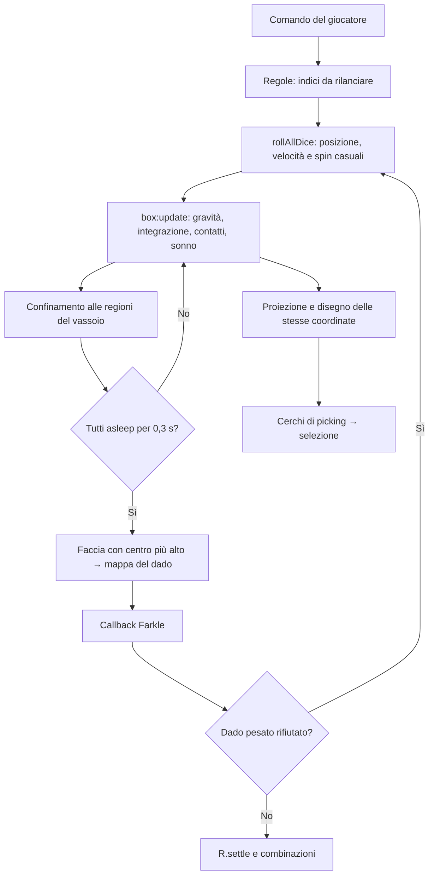

# Manuscript — Audit tecnico del motore 3D

Data: 14 ottobre 2026. Oggetto: sorgenti attuali del motore condiviso e integrazione nel prototipo Farkle Roguelite. Nessuna miglioria implementata.

**Giudizio preliminare: il motore merita di essere conservato.** È un sistema funzionante, leggero per sei dadi sulla macchina provata e realmente guidato dalla geometria simulata. Non emerge una ragione per riscriverlo o migrare framework. Non è però una simulazione rigorosa di corpi cubici: le collisioni fra dadi, alcune correzioni esterne al passo fisso e i vincoli del vassoio presentano limiti riproducibili. È adeguato a proseguire il prototipo; non considererei ancora conclusa la validazione della fisica o dell'imparzialità prima di consolidare il gioco definitivo.

Le parole **verificato nel codice**, **riprodotto**, **rischio** e **proposta** indicano livelli diversi di evidenza. Le priorità non sono una richiesta di riscrittura: gli interventi proposti sono separabili e richiedono successiva autorizzazione.

## 1. Architettura effettiva del motore

### Ambito, metodo e riproducibilità

Esaminati `main.lua`, `core.lua`, tutti i moduli `src/engine3d`, configurazione, ordine degli aggiornamenti, adattatore Farkle, mappatura delle facce e proiezione del prototipo. I numeri di riga citati si riferiscono ai sorgenti fotografati in [source-hashes.json](../../audits/engine3d/source-hashes.json).

Strumenti nuovi confinati in `audits/engine3d/`: caricano copie byte per byte dei sorgenti originali in un pacchetto LÖVE separato. Nessuna modifica ai file del gioco, alla fisica o ai risultati per far passare i test. Verifica finale: **93 file sorgente/configurazione/documentazione controllati, zero cambiamenti**, [integrity.json](../../audits/engine3d/integrity.json). L'identità LÖVE dell'audit è distinta da quella del prototipo. Log e pacchetto di prova sono separati; non è stato rigenerato il launcher del gioco.

Comandi dalla radice del progetto:

```text
rtk proxy python audits/engine3d/run.py
rtk proxy python audits/engine3d/analyse.py
rtk proxy python audits/engine3d/run.py --focused
rtk proxy python scripts/test_luajit.py tests/dice_config_test.lua tests/game_manager_hooks_test.lua experiments/farkle_roguelite/test.lua experiments/farkle_roguelite/test_hud.lua
```

Servono il Python già installato e LÖVE in `C:/Program Files (x86)/LOVE/love.exe`. Nessuna libreria aggiunta. Il primo comando riproduce il campione e le prove isolate; il secondo calcola le statistiche; il terzo le verifiche geometriche e gli screenshot finali. I test esistenti sono passati, 4 file su 4. Non provano da soli la correttezza fisica: ad esempio il test della configurazione controlla lo schema, non l'associazione finale degli argomenti a `box:set`.

L'harness usa gli aggiornamenti originali a intervalli controllati, accelerando il tempo di laboratorio senza modificare il `dt` ricevuto dalla simulazione. Nella parte statistica intercetta **soltanto il destinatario** del callback finale per registrare i risultati e impedire che commissioni/ricompense arrestino il campione. Non sostituisce valori, orientamenti o condizioni di arresto. Nelle prove grafiche ripristina il callback originale e usa davvero `U:request`, `R.settle` e selezione mouse.

### Componenti e flusso

| Componente | Implementazione effettiva e riferimenti |
|---|---|
| Algebra | `core.lua`: vettori come tabelle con operatori; prodotto scalare tramite `..`, vettoriale tramite `^`. Rotazione asse-angolo convertita in quaternione e coefficienti precalcolati. Ogni operazione vettoriale restituisce una nuova tabella. |
| Geometria | `src/engine3d/geometry.lua:8`, `newD6Body`: otto vertici di un cubo. Il parametro 0,92 diventa semilato 0,575, lato effettivo 1,15. Sei liste di quattro indici; facce opposte 1/6, 3/4, 5/2. Esiste anche D8, sei vertici e otto facce triangolari, non usato nel Farkle. |
| Stato dinamico | `physics.lua:362`, `body:set`: posizione, velocità lineare, velocità angolare, massa, inverso della massa, inerzia scalare `theta`, vertici già ruotati, raggio approssimativo e stato di sonno. Non esiste un orientamento persistente separato: i vertici vengono ruotati a ogni passo. |
| Camera | `view.lua`, `project/get/raise/turn/move`: rotazione yaw sul piano XY, poi pitch, prospettiva `focus/(distance-z)`. `get` ricostruisce la posizione della camera con le inverse. Non è una camera fornita da una libreria 3D. |
| Rendering | `render.lua:244`, `zbuffer/paint`, e `:367`, `die`: proiezione CPU, normali delle facce, eliminazione delle facce rivolte altrove, poligoni/immagini 2D LÖVE. Il nome `zbuffer` indica una coda ordinata per profondità, **non un depth buffer per pixel**. |
| Illuminazione | `light.lua`, `generic`: luce puntiforme, attenuazione limitata, termine diffuso e speculare semplificato per faccia. `plastic` usa anche una risposta minima/diffusa sui lati non illuminati. Nessun BRDF fisicamente calibrato. `follow` esiste ma non è chiamato dall'ordine attivo del Farkle. |
| Ombre | `render.lua:486`, `shadow`: proietta i vertici dal punto luce sul piano z=0 e costruisce un inviluppo 2D. **Nel vassoio attuale le ombre sono disabilitate**, `src/data/tray_layout.lua`, `overlay.shadows=false`. Non si possono attribuire al prototipo ombre dinamiche che non vengono disegnate. |
| Materiali | Due livelli: `physics.materials` con massa/attriti/smorzamenti e `die.material` come funzione di luminosità. Il preset fisico attivo è `bone`; l'illuminazione iniziale è `light.plastic`. Non sono lo stesso materiale né una corrispondenza automatica. |
| Testure | `render.lua:79`, cache immagini; `:31`, trasformazione affine 2D. `geometry.d6.image` usa la mappa del template. Nel Farkle `dice.lua:24`, `D.install`, sostituisce la funzione con una closure sulla mappa del singolo dado. |
| Vassoio | Piano, cornice suddivisa in triangoli e cache in `render.tray_border`; bordo testurizzato disabilitato. `main.lua:396` aggiunge un confinamento trapezoidale dei centri indipendente dalle sei pareti della scatola fisica. |
| Temporizzazione | `execution_order_plan.lua`: refresh risoluzione → `box:update(dt)` → confinamento regioni → controllo arresto → update modulo; camera dopo l'update, vassoio dopo il disegno HUD. `physics.lua:86` contiene l'accumulatore e i sottopassi. |
| Risultato | `main.lua:1376`, `readDieFace`: trova la faccia con media delle coordinate z locali dei vertici più alta, poi legge `faceValueMap`/`pipMap`. La traslazione non cambia il confronto. |
| Arresto | `main.lua:1302`, `checkDiceSettled`: tutti i corpi devono avere `asleep=true`, poi attesa di 0,3 secondi di aggiornamento. `onDiceSettled` legge solo gli indici del lancio e invia evento/callback. |
| Selezione | `main.lua:513`, `pick_tray_die_at_screen`: cerchi proiettati, scelta della distanza normalizzata dal centro, profondità solo a parità. `EngineBridge.pickTrayDie` espone il picking al modulo. |
| Farkle | `ui.lua:41/46/59`: avvio fisico, raccolta valori, eventuali rilanci del dado pesato, `R.settle`. `rules.lua` valuta punteggi e stato senza geometria. `app/main.lua:14` esclude temporaneamente dal contenitore fisico i dadi accantonati, poi ripristina l'elenco. |



### Parametri realmente attivi

Misurati dopo il caricamento del prototipo, non dedotti dalle etichette dello schema:

| Proprietà | Valore |
|---|---:|
| Gravità | 25 unità/s² verso -Z |
| Passo fisico | 0,01 s, 100 Hz |
| Massimo sottopassi per update | 5 |
| Restituzione globale usata fra dadi | 0,25 |
| Attrito globale fallback delle pareti | 0,75 |
| Massa dado bone | 1,8 |
| Inerzia scalare dado D6 attivo | 0,38021875 |
| Raggio delle collisioni sferiche | 0,74694691 |
| Restituzione/attrito body bone sulle pareti della box | 0,30 / 0,80 |
| Smorzamento lineare/angolare body bone | 0,12 / 0,18 |
| Semidimensioni box X/Y, soffitto Z | 7,2 / 3,4 / 10 |
| Altezza visiva del bordo | 0,74 |

Le unità sono interne: non sono dichiarati metri, chilogrammi o secondi fisicamente calibrati per tutti i coefficienti. L'inerzia di un cubo uniforme è isotropa: una **inerzia scalare è appropriata per il cubo omogeneo**, ma il valore attuale è un parametro empirico e non viene ricalcolato cambiando materiale.

## 2. Aspetti tecnicamente ben realizzati

1. **Un'unica geometria guida immagine e lettura del risultato.** Il lancio normale non estrae un numero da mostrare dopo una falsa animazione. La rotazione finale non viene riallineata a una faccia prefissata. Il callback riceve la faccia geometrica.
2. **Separazione già utile fra motore e regole.** Il valutatore Farkle è testabile senza LÖVE; eventi e callback delimitano il risultato della simulazione. Questo è un punto da conservare per medaglie ed effetti.
3. **Passo interno fisso e protezione contro il lavoro illimitato.** L'accumulatore è una base corretta; il limite di cinque passi impedisce una spirale di recupero. I problemi riguardano come vengono scartati i residui e le correzioni esterne, non la scelta di avere un passo fisso.
4. **Rotazioni numericamente stabili nel test.** Dopo 100.000 integrazioni a 0,01 s con spin costante, massimo scarto del raggio di un vertice: `1,26×10⁻¹³`. Nessuna necessità dimostrata di sostituire l'algebra o aggiungere normalizzazioni frequenti.
5. **Contatti con i piani basati sui vertici reali.** Il braccio della forza produce spin negli urti con il fondo; non è una semplice palla che rimbalza senza orientamento.
6. **Costo contenuto per sei oggetti.** La scansione iniziale degli intervalli elimina coppie lontane. Con sei dadi ci sono al massimo 15 coppie: un limite quadratico qui non è da solo un problema.
7. **Rendering robusto per la camera controllata.** Normali corrette verso l'esterno, filtri per coordinate non valide, quad suddivisi in triangoli, cache delle immagini e del bordo, ordinamento stabile a pari profondità.
8. **Inquadratura e input condividono la proiezione.** Nel test a entrambe le risoluzioni tutti i vertici monitorati restano nell'area assegnata; 6 centri su 6 sono selezionabili. Il clic reale su una faccia valida produce una selezione da 50 punti.
9. **Arresto ordinario riuscito nel campione.** 300/300 lanci indipendenti controllati e 100/100 consecutivi sono terminati entro il limite di prova. Le facce finali del campione principale hanno allineamento verticale minimo 0,9998626, circa 0,95° dalla verticale. Il riconoscimento non è ambiguo in questi casi.

## 3. Difetti dimostrati

### D1 — Parametri dello schema collegati a proprietà diverse dal nome — P1

**File/funzioni:** `main.lua:821`, `configure_dice_box`; `physics.lua:77`, `box:set`; `dice_scene_schema.lua`, `box`.

**Causa verificata:** la firma è `(x,y,z,gravity,bounce,friction,dt)`, mentre il chiamante passa `(half_x,half_y,height,depth,wall_thickness,wall_bounce,friction)`. Quindi `depth=25` diventa gravità, `wall_thickness=0.25` restituzione, `wall_bounce=0.75` attrito, `friction=0.01` passo temporale. Il log runtime conferma l'intera associazione.

**Effetto:** cambiare il campo chiamato «friction» cambierebbe la frequenza della fisica; cambiare lo spessore della parete cambierebbe gli urti fra dadi. Non prova che i valori attualmente scelti siano sbagliati: prova che modificarli seguendo i nomi è pericoloso.

**Riproduzione:** avviare l'audit e leggere `runtime box`. **Soluzione proposta:** introdurre nomi espliciti e un test del collegamento end-to-end, preservando inizialmente i valori effettivi per non alterare il comportamento. **Rischio regressione:** basso se cambia solo la descrizione/mappatura mantenendo i valori; alto se si reinterpretano subito i numeri. **Beneficio:** configurazione affidabile per ogni futura calibrazione.

### D2 — Correzioni fuori dal passo fisso e perdita di tempo — P1

**File/funzioni:** `physics.lua:86`, `box:update`, specialmente 325 e 329–348; `main.lua:396`, confinamento per frame.

**Riprodotto:** con due dadi distanti 1 e sovrapposti nelle sfere, `update(0)` porta la distanza a 1,395115: il sistema cambia senza avanzare il tempo. La separazione finale è eseguita una volta per chiamata, non per sottopasso; anche il confinamento trapezoidale avviene per frame.

In moto libero a velocità 1 per un secondo, stessa box a 100 Hz e smorzamento disattivato per isolare il tempo:

| Update esterno | Spostamento osservato |
|---|---:|
| 10 Hz | 0,50 |
| 20 Hz | 0,90 |
| 30 / 60 / 144 Hz | 0,99 |

La condizione strettamente `timeleft > dt` lascia un passo residuo; raggiungendo il tetto di cinque passi il codice azzera tutto il residuo. A 20 Hz anche gli arrotondamenti interagiscono col tetto. Il rallentamento a 10 Hz è deliberatamente protettivo nel costo, ma non conserva il tempo trascorso.

Su 12 seed e pose iniziali identiche, nessuna delle 12 sestine finali a 30 o 144 Hz coincide interamente con la sestina a 60 Hz. Non è prova di distribuzione distorta: le traiettorie sono sensibili alle perturbazioni. È prova che «passo interno fisso» non rende qui il risultato indipendente dalla cadenza esterna.

**Soluzione proposta:** portare correzioni e confinamento nello stesso calendario fisico; definire esplicitamente la politica dei residui/catch-up. **Rischio:** alto per le traiettorie e per le distribuzioni, da ricampionare; basso per l'interfaccia se i contratti restano uguali. **Beneficio:** riproducibilità e velocità temporale coerenti, più importanti di un'accelerazione CPU.

### D3 — Sfere non conservative per cubi e separazione degenerata — P1

**File/funzioni:** `physics.lua:199–318`, contatti fra corpi; `:362`, raggio `0.75 × distanza del vertice`; `:329`, separazione finale.

**Riprodotto:** due cubi con semilato 0,575, entrambi ruotati 45° su Z e centri distanti 1,55, hanno profondità di sovrapposizione geometrica 0,053984 secondo SAT sui 15 assi dei cubi. La somma dei raggi è solo 1,493894: la collisione è scartata. In direzioni diverse la sfera genera invece separazione anticipata prima che le superfici cubiche si tocchino.

Una verifica indipendente della geometria finale su **40 seed del campione principale** trova sovrapposizioni maggiori di 0,001 in **5 lanci**, profondità massima 0,071923, circa 6,25% del lato. Non sono 40 nuovi campioni statistici: sono una riesecuzione mirata. Il SAT è usato come strumento di misura, non sostituisce la fisica.

Centri perfettamente coincidenti sono saltati da `dist>0` e `dist>0.01`. Sei cubi inizialmente coincidenti finiscono tutti asleep e conservano 15 coppie sovrapposte dopo 20 s. Pile iniziali con distanze verticali 0,1 e 1,15 conservano 5 coppie sovrapposte. Sono stress test costruiti, non tassi di incidenza durante il gioco normale.

**Soluzione proposta:** mantenere una fase grossolana economica ma conservativa, aggiungendo verifica geometrica dei contatti e una gestione deterministica dei centri coincidenti. La sola crescita del raggio non risolve i contatti falsi. Un SAT di rilevamento, da solo, non basta a produrre un buon risolutore: normali, punti di contatto e separazione devono essere coerenti.

**Rischio:** medio-alto, perché cambia la traiettoria di ogni interazione. **Beneficio:** meno compenetrazioni, contatti più credibili e base migliore per dadi differenti. Non serve adottare un intero motore esterno.

### D4 — Correzioni positional possono reintrodurre penetrazione nel fondo — P1

**File/funzioni:** `physics.lua:90`, ordine integrazione/pareti/coppie; `:329–348`, separazione finale; controlli di sonno a 95–195.

**Riprodotto:** due cubi inizialmente addormentati, allineati verticalmente e distanti 1,45, vengono separati spingendo il dado inferiore sotto z=0: minimo -0,017558 dopo `update(0)`, -0,021069 dopo i passi successivi misurati. Non c'è una proiezione finale su tutti i vincoli né un solver iterativo dei contatti multipli. Il preset di sonno può inoltre accettare vertici già leggermente sotto il piano.

Nel campione principale ordinario il minimo finale è -0,008001, circa 0,7% del lato; nella riesecuzione geometrica 1 dado su 240 supera -0,001. Non è dimostrato un attraversamento completo del fondo durante lanci ordinari.

**Soluzione proposta:** correzione coerente dei vincoli e criterio di sonno successivo alla risoluzione dei contatti; definire una tolleranza numerica esplicita. **Rischio:** medio-alto per tempi di arresto e distribuzione. **Beneficio:** stabilità delle pile e assenza di riposo dentro il piano. Da trattare insieme a D2/D3, evitando correzioni isolate che si contrastino.

### D5 — Vincoli del vassoio non corrispondenti alla geometria visibile — P1

**File/funzioni:** `main.lua:396`, `constrain_dice_to_regions`; `:381`, estensioni del piano; `physics.body:box`; `render.tray_border`.

**Verificato e riprodotto:** la box ha pareti sino a z=10, ma il bordo disegnato è alto 0,74. Il confinamento trapezoidale agisce sul centro a qualsiasi altezza, senza punto di contatto o torque. Un dado con centro `(0,4,5)` passa a y=2,6765265 già con un update nullo: è respinto molto sopra il bordo visibile. L'azione avviene anche su un dado marcato `kept`, perché il vincolo regionale non controlla quel flag.

Il margine D6 è metà del raggio sferico, circa 0,3735, inferiore anche al semilato 0,575. Nella riesecuzione dei 40 lanci un vertice finale oltrepassa il limite visivo anteriore/posteriore y=±3,05 fino a **0,348059**. Questo non implica che il dado esca dal contenitore numerico: il limite più esterno della box è ±3,4. Spiega possibili intersezioni/occlusioni sul bordo.

**Interpretazione:** il contenimento alto può essere una scelta di gioco ragionevole per impedire dadi fuori campo. Non va però descritto come collisione esatta col bordo di legno.

**Soluzione proposta:** definire una sola geometria di riferimento e distinguere esplicitamente contenimento di gioco e contatto visivo; usare estensioni dei vertici per i margini. Conservare il comportamento attuale finché non è decisa la politica sui dadi fuori vassoio. **Rischio:** medio-alto, perché cambia lancio dalle pareti e frequenze. **Beneficio:** coerenza visiva/fisica senza cambiare dimensioni o HUD.

### D6 — Equilibrio simmetrico sullo spigolo non risolto — P1 prima della pubblicazione

**File/funzioni:** `physics.lua`, `body:wall`, sonno e riconoscimento piano; `main.lua:1302`, `checkDiceSettled`.

**Riproduzione:** un solo D6 a riposo sul fondo, ruotato esattamente 45° intorno a X, velocità e spin iniziali zero, gravità 25. Dopo 20 s simulati: `asleep=false`, differenza fra le due facce più alte = 0. Il test non dimostra che non si fermerà mai, ma dimostra mancata risoluzione entro una durata lunga rispetto al lancio normale.

**Causa:** il contatto simmetrico e le correzioni non scelgono una faccia; il controllo globale attende tutti i corpi, senza watchdog. Non si deve correggere scegliendo silenziosamente un numero. Nei 400 lanci ordinari campionati questo problema non è comparso.

**Soluzione proposta:** criterio esplicito di dado ambiguo e rilancio fisico dichiarato dopo stallo, oppure migliorare i contatti per eliminare il bilanciamento artificiale. **Rischio:** medio; un rilancio automatico può introdurre selezione statistica se il criterio dipende dalla faccia. **Beneficio:** evitare turni che restano in attesa; testare il criterio su tutte le orientazioni simmetriche.

### D7 — CCD limitato e impulso applicato anche in separazione — P2 nel dominio attuale

**File/funzioni:** `physics.lua:230–286`, ramo CCD; `:413`, `body:wall`.

Il calcolo del tempo d'impatto fra sfere viene tentato **solo se le sfere sono già sovrapposte a fine passo**. Due corpi da x=-2/+2, velocità +500/-500, passo 0,01, si scambiano di lato senza urto: x=+3/-3. Queste velocità sono molto superiori al lancio normale; il test prova un limite dell'algoritmo, non un difetto frequente del prototipo.

`body:wall` applica la risposta in base alla penetrazione senza verificare che la velocità di contatto sia entrante. Chiamando il contatto con normale +Z su un corpo che si muove già verso +Z a velocità 1, la velocità del centro scende a 0,685263 e viene introdotto spin. La condizione è riproducibile tramite l'API; la frequenza durante le partite non è misurata.

**Soluzione proposta:** distinguere correzione geometrica e impulso entrante; se servono velocità maggiori, usare intervalli spazzati anche nella selezione delle coppie. **Rischio:** medio per la dinamica; **beneficio:** evitare rimbalzi aggiuntivi e tunneling nel dominio esteso. Non introdurre CCD generale soltanto per risolvere un test a 500 unità/s.

### D8 — Immagine delle facce affine, non prospetticamente corretta — P2

**File/funzioni:** `render.lua:31`, `graphics_transform`; `geometry.lua:26`, `d6.image`; `experiments/farkle_roguelite/dice.lua:29`.

Il poligono usa quattro vertici proiettati; l'immagine usa solo primo, secondo e quarto e una trasformazione affine. Il terzo non determina la deformazione. Un quadrilatero prospettico generale non è un parallelogramma.

**Riprodotto:** cubo ruotato 0,5 radianti sull'asse (1,1,0), camera pitch 0,4, centro z=0,9: differenza fra quarto angolo dell'immagine trasformata e corrispondente vertice proiettato **0,024574 unità di proiezione**. In pixel dipende dalla scala corrente; non è una misura fissa per ogni lancio. L'inquadratura lontana limita normalmente la distorsione.

**Soluzione proposta:** mesh UV delle facce o proiezione prospettica corretta se l'artefatto è visibile nelle viste desiderate. **Rischio:** medio per winding, trasparenze e simboli. **Beneficio:** facce decorate più fedeli, soprattutto con simboli asimmetrici o zoom; non prioritario rispetto alla correttezza dei contatti.

## 4. Rischi e limitazioni non ancora dimostrati nel gioco ordinario

| Rischio/limite | Evidenza e confine della conclusione | Priorità e verifica utile |
|---|---|---|
| Ordine di profondità errato per facce intersecanti | `render.paint` ordina profondità medie; bordo usa profondità minima dei triangoli. Nessun depth test per pixel. La correttezza generale non è garantita, specialmente con D3; non è stato isolato un fotogramma ordinario con ordinamento sicuramente sbagliato. | P2; scena controllata di occlusione con geometria non compenetrante prima di cambiare renderer. |
| Picking su dado nascosto o fuori sagoma | Cerchi ingranditi e priorità per vicinanza normalizzata, non ray casting delle facce. I clic centrali passano; non dimostrano correttezza su ogni pixel in sovrapposizione. | P2, P1 se emerge un errore d'uso ripetuto; confrontare punti di occlusione e mantenere indicatori 1–6. |
| Dado inclinato accettato dal sonno generico | Il secondo criterio controlla velocità e `position.z < 1.2`, non angolo della faccia/supporto. Il lettore risolve i pari scegliendo la prima faccia, senza flag d'ambiguità. Nel campione ordinario tutte le facce sono quasi orizzontali. | P1 insieme a D6; costruire casi di appoggio su altro dado/parete. |
| Materiali fisici incoerenti fra tipi di contatto | Verificato staticamente: coppie usano restituzione della box, attrito fisso 0,3 e impulsi senza braccio. Nessun trasferimento di spin dagli urti dado-dado. Pareti usano invece il materiale del corpo; regioni coefficienti propri. Non è un crash o una falsificazione del numero. | P1 prima di vendere materiali con comportamento fisico significativo. |
| Inerzia non aggiornata dal materiale | `materials.apply` cambia massa, non `theta`. Il valore attivo è vicino ma non uguale all'inerzia di un cubo bone uniforme (0,39675). Cambiando massa la relazione non resta coerente. | P1 per materiali/COM diversi; nessuna ragione di alterare subito il preset attuale senza test. |
| Attrito tangenziale tra dadi | Nel ramo non-CCD compare `tangent_mag * denom`, dove `denom=invMassA+invMassB`; un impulso che annulli la velocità richiederebbe la divisione, prima del limite di Coulomb. Il limite può mascherare la differenza; non misurato un errore di gameplay attribuibile solo a questo. | P1 per masse eterogenee; prova analitica a due corpi senza limite attivo prima dell'intervento. |
| Corpi a massa zero | Nel post-pass diventano inverso massa 0,5 mentre nel ramo impulsi sono statici; `wall` può avere denominatore nullo. Non esistono dadi statici a massa zero nella configurazione corrente. | P2, o P1 prima di supportare corpi statici come dadi/ostacoli. |
| Correlazione e bias statistico | Pose precedenti, spawn da quattro lati, jitter dipendente dall'indice, angoli non reinizializzati, contatti e soglie possono introdurli. Assenza di significatività nel campione non dimostra indipendenza o uniformità esatta. | P1 come validazione prima del bilanciamento finale; protocollo sotto. |
| Camera vicino al piano di proiezione | `view.project` non effettua clipping geometrico; renderer scarta facce fuori soglia. Non un problema osservato con camera bloccata e limiti attuali. | P2, solo se si abilita camera libera/zoom ravvicinato. |
| Cache/input aggiornati nel disegno | Picking ricostruito a ogni draw, azzerato al resize. Rendering modifica temporaneamente pitch/posizione (offset) e ripristina senza protezione completa da errore. | P2; separare lo stato di vista se si introduce multivista o rendering asincrono. |
| Gestione errori | `EngineBridge` protegge alcune chiamate con `pcall` e restituisce nil/0, ma può nascondere la causa; immagini mancanti e callback invalido possono invece sollevare errori. Il clamp impulsi scrive log sincroni su disco. | P2; migliorare diagnostica solo nei percorsi necessari, nessun crash ordinario osservato. |

La luce mobile è codice disponibile, non attivo nel ciclo osservato: il suo consumo di `math.random` e il suo aggiornamento dipendente dal frame non vanno attribuiti ai risultati attuali. Anche D8 e ombre hanno ricevuto esame statico, **non una campagna quantitativa equivalente ai sei D6**.

## 5. Possibili miglioramenti

Conservare geometria di base, algebra, aspetto, proiezione, API dei risultati e valutatore. Le proposte seguenti non sono state applicate.

1. **Prima rendere osservabili i contratti:** nomi corretti per configurazione, stato di lancio con seed e condizioni iniziali, test sulla corrispondenza faccia/valore, limite di stallo dichiarato. Sono prerequisiti per verificare ogni cambiamento.
2. **Poi sistemare il calendario fisico:** un luogo coerente per integrazione, contatti, vincoli e sonno. Non basta sostituire `>` con `>=`: resterebbero correzioni per frame, azzeramento dei residui e confinamento esterno.
3. **Contatti cubici locali:** broad phase conservativa e narrow phase adeguata ai soli dadi supportati; iterazioni limitate per contatti multipli. Sei oggetti non richiedono infrastrutture da simulazione di grandi scene. Prima stabilire tolleranze e comportamento desiderato delle pile.
4. **Geometria del vassoio condivisa:** descrizione unica per render e collisioni, con eventuale contenimento di gioco separato e documentato. Non cambiare dimensioni visive per nascondere il problema.
5. **Ambiguità esplicita:** misurare allineamento e margine fra facce; mai trasformare un pareggio geometrico in un risultato scelto per convenienza del gioco.
6. **Solo dopo valutare finiture grafiche:** UV/prospettiva delle facce, ombre di contatto opzionali, picking poligonale. La mancanza di ombre è una scelta attuale; la loro introduzione richiede una verifica visiva, non è una correzione indispensabile.

Non propongo pooling generalizzato, riscrittura in C, GPU physics, ECS o un nuovo framework: nessuna misura raccolta li giustifica. Se si interviene su un problema fisico, registrare nuovi campioni comparabili e mantenere gli screenshot di riferimento; una dinamica diversa non si può validare soltanto verificando che l'applicazione si avvii.

## 6. Prestazioni misurate e imparzialità dei lanci

### Prestazioni

Ambiente registrato: LÖVE 11, LuaJIT `2.1.1700008891`, OpenGL 3.3 NVIDIA 617.14, **GeForce RTX 5080**. Non è un test su hardware minimo. La query del processore tramite CIM non era disponibile; non è stato inventato un modello CPU. VSync disabilitato nel laboratorio, limitatore FPS disattivato nella fase grafica. Le prove misurano tempo di esecuzione CPU con timer LÖVE, non il tempo simulato.

| Misura | N | Media ms | Mediana ms | p95 ms | Max ms |
|---|---:|---:|---:|---:|---:|
| `box:update`, campagna principale | 105.356 | 0,0581 | 0,0384 | 0,1824 | 0,8942 |
| Update completo, 1280×720 | 240 | 0,0965 | 0,0637 | 0,3021 | 0,6108 |
| Disegno completo + invio batch, 1280×720 | 240 | 0,9556 | 0,4227 | 0,9030 | 108,1140 |
| Presentazione, 1280×720 | 239 | 0,1766 | 0,1371 | 0,3617 | 1,1911 |
| Update completo, 1920×1080 | 240 | 0,0990 | 0,0634 | 0,2586 | 0,8780 |
| Disegno completo + invio batch, 1920×1080 | 240 | 0,4843 | 0,4207 | 0,8645 | 1,3010 |
| Presentazione, 1920×1080 | 239 | 0,1827 | 0,1419 | 0,4255 | 1,0232 |

Fonti: [observations.txt](../../audits/engine3d/observations.txt) per la campagna e [focused.txt](../../audits/engine3d/focused.txt) per l'ultima verifica grafica. Il costo medio combinato delle tre fasi grafiche è circa 1,23 ms a 720p, 0,77 ms a 1080p; il valore 720p include il picco iniziale. Non sono FPS garantiti: `present` e flush non sono una misura separata del tempo GPU, e l'ambiente sintetico non include tutte le attese del desktop o interazioni reali.

**Picco concreto:** circa 108 ms nella prima sequenza grafica, osservato anche nelle riesecuzioni (~103–108 ms), contro p95 sotto 1 ms. Compatibile con inizializzazione/caricamenti/cache/JIT/driver; non profilato abbastanza per attribuirlo a una singola funzione. Un preload misurato può essere P2; non giustifica ottimizzare tutta la fisica.

Allocazioni: vettori, intervalli broad phase, liste di facce e closure di disegno vengono creati frequentemente. La coda del bordo è memorizzata, le texture sono in cache; il lavoro dinamico resta piccolo. Le variazioni grezze dell'heap nel test più recente sono +346 KB e +676 KB, ma in riesecuzioni sono state anche negative per effetto del GC. **Non costituiscono una prova di leak**, né una misura di allocazioni al secondo. Non eseguita profilazione delle allocazioni per funzione o prova di memoria di molte ore.

### Risultati normali: origine fisica e correzioni

La faccia viene letta dai vertici realmente disegnati. Non trovati snap dell'orientamento verso un numero desiderato o override casuali del risultato normale. Sono invece presenti correzioni **della dinamica**: smorzamenti, azzeramento di spin Z piccolo, sonno, contenimento dei centri, separazione posizionale, spinta verso l'interno vicino al bordo e attenuazione dopo 150 contatti con pareti. Queste possono influenzare la distribuzione pur senza scegliere direttamente una faccia.

`body:push` limita ogni incremento di velocità lineare a 50, non la velocità totale; lo spin non ha un limite equivalente. Le undici micro-applicazioni dell'impulso in `wall` sono una stabilizzazione numerica, non undici sottopassi temporali. Il sistema non conserva energia o quantità di moto globali attraverso tutte queste correzioni, e non pretende una simulazione isolata senza dissipazione.

La corrispondenza visuale è corretta nel percorso Farkle attivo: immagine e valore leggono la stessa mappa individuale. Non si può estendere la parola «sempre» a ogni geometria futura: il lettore assume facce regolari a distanza comparabile dal centro, manca il flag di ambiguità e il renderer base D6 usa ancora la mappa del template.

### Campione principale: 300 lanci, 1.800 facce

Seed `50001…50300`; reset dell'intero stato iniziale dei sei corpi e accumulatore prima di ogni lancio; stessa posa iniziale del programma, spin/posizione/velocità ottenuti dall'originale `rollAllDice`; aggiornamento esterno 60 Hz. I dadi interagiscono fra loro. Tutti hanno raggiunto il callback entro 30 s simulati: tempo medio 3,8242 s, massimo 13,2667 s. Non esclusi esiti scomodi, non rilanciati risultati per ottenere uniformità.

| Faccia | Conteggio | Frequenza | IC 95% approssimato, raggruppato per lancio |
|---|---:|---:|---:|
| 1 | 326 | 18,11% | 16,28–19,94% |
| 2 | 310 | 17,22% | 15,51–18,93% |
| 3 | 298 | 16,56% | 14,80–18,31% |
| 4 | 282 | 15,67% | 13,86–17,48% |
| 5 | 313 | 17,39% | 15,61–19,17% |
| 6 | 271 | 15,06% | 13,39–16,72% |

Il valore teorico uniforme è 16,6667%. Gli intervalli usano la deviazione standard della frazione di ciascuna faccia nei **300 lanci**, divisa per √300 e moltiplicata per 1,96: evitano di assumere indipendenza fra sei dadi che collidono nello stesso lancio. Sono intervalli marginali approssimati, non simultanei e non una certificazione.

Per controllare anche differenze fra posizioni nel set, test chi-quadro per ciascun dado su 300 osservazioni (atteso 50 per faccia, 5 gradi di libertà):

| Dado | Conteggi facce 1/2/3/4/5/6 | χ² | p nominale |
|---|---|---:|---:|
| 1 | 60 / 54 / 45 / 45 / 55 / 41 | 5,44 | 0,365 |
| 2 | 51 / 57 / 52 / 49 / 50 / 41 | 2,72 | 0,743 |
| 3 | 62 / 52 / 42 / 51 / 54 / 39 | 7,00 | 0,221 |
| 4 | 65 / 51 / 46 / 38 / 49 / 51 | 7,76 | 0,170 |
| 5 | 43 / 52 / 60 / 43 / 52 / 50 | 4,12 | 0,532 |
| 6 | 45 / 44 / 53 / 56 / 53 / 49 | 2,32 | 0,803 |

Nessuno è significativo nemmeno prima di correggere i sei confronti; una correzione Holm non cambierebbe questa conclusione. Non è la probabilità che il motore sia corretto. Non è un test di equivalenza entro un margine prestabilito. Il campione non esclude bias piccoli né dipendenze fra dadi.

### Lanci consecutivi, frame rate e riproducibilità

Ulteriore sequenza di 100 lanci, seed iniziale 99001 e orientamenti conservati fra i lanci come in partita: 100/100 conclusi, media 3,8205 s, massimo 10,95 s. Conteggi aggregati: **121 / 99 / 100 / 95 / 93 / 92**. Il 20,17% di 1 merita monitoraggio, ma è una singola sequenza piccola e potenzialmente autocorrelata: non è una prova automatica di dado truccato. Gli intervalli nominali seriali in `statistics.json` non correggono tale autocorrelazione; usarli solo descrittivamente.

12 seed `70001…70012`, stesso stato iniziale a ogni cadenza:

| Update esterno | Lanci conclusi | Facce individuali uguali alla prova 60 Hz | Tempo medio simulato al callback |
|---|---:|---:|---:|
| 10 Hz | 12/12 | 26/72 | 7,342 s |
| 30 Hz | 12/12 | 27/72 | 3,989 s |
| 60 Hz | 12/12 | 72/72, riferimento | 3,914 s |
| 144 Hz | 12/12 | 26/72 | 4,744 s |

Non usare questi 12 lanci per confrontare distribuzioni: servono a mostrare dipendenza della traiettoria dal calendario esterno. Replay dello stesso seed 99117, stato completo e dt uguali: **risultati uguali e massimo scarto delle pose finali 0** sulla stessa macchina/runtime. Non verificata identità bit per bit fra processori o versioni LÖVE.

Il solo seed non basta in partita: `rollAllDice` conserva i vertici orientati dal lancio precedente; servono stato precedente, lista dadi accantonati, accumulatore, sequenza dei dt e stati degli RNG. `seed_rng` usa il tempo in secondi per inizializzare sia RNG Lua sia LÖVE, quindi avvii nello stesso secondo possono condividere il seed. Non è un sistema di casualità crittografica, né è richiesto per il prototipo locale.

### Protocollo statistico raccomandato, non ancora eseguito

Prima di bilanciare: fissare versione, configurazione, criterio di faccia ambigua e precisione desiderata; separare lanci indipendenti, sequenze di gioco, rilanci parziali e dado isolato. Registrare seed, pose, dt, timeout, faccia fisica e valore mappato, non soltanto il totale. Provare posizioni nel set e lati di spawn; controllare matrici di transizione e correlazioni intra-lancio. Ripetere i campioni dopo ogni cambiamento fisico.

Per una stima binomiale di una faccia vicina a 1/6, precisione marginale indicativa ±1 punto percentuale al 95% richiede circa **5.336 osservazioni indipendenti**; ±2 punti circa 1.334. Correlazioni, confronti multipli ed equivalenza richiedono un disegno più prudente. Non ho eseguito questa campagna estesa. Una soglia di tolleranza progettuale va dichiarata prima di giudicare la distribuzione «abbastanza uniforme».

## 7. Compatibilità con dadi pesati e facce intercambiabili

### A. Dadi pesati

**Situazione attuale:** massa scalare e inerzia scalare, centro della geometria coincidente col centro dinamico. Cambiare solo la massa non introduce uno sbilanciamento direzionale delle facce. Il sistema non rappresenta oggi un baricentro decentrato né una distribuzione interna di massa.

Il prototipo implementa un'alternativa esplicita in `dice.lua:5`, `D.accept`, e `ui.lua:59`: risultato 1 sempre accettato, altri accettati con probabilità 1/2; al rifiuto si rilancia **fisicamente** D1 dopo 0,65 s. Nessuno scambio segreto fra faccia visibile e valore registrato. È campionamento per accettazione, non un dado fisicamente zavorrato. Non esiste un limite massimo di tentativi nel codice.

I pesi dichiarati 2:1:1:1:1:1 sono esatti **solo se le proposte sono uniformi e sufficientemente indipendenti**. Con probabilità base `p(v)` e proposte identicamente distribuite, la probabilità accettata è `p(v)·a(v) / Σ p(k)·a(k)`. Se orientamenti persistenti rendono le proposte correlate, nemmeno questa formula basta senza modellare il processo. `D.probabilities` e il rischio HUD restano teorici: non sono una misura della fisica. L'audit non ha misurato una distribuzione pesata né validato i pesi 2:1 nella simulazione.

**Possibilità coerenti:**

- Conservare il rilancio dichiarato, misurando la distribuzione reale e il costo di attesa: beneficio basso costo di integrazione, rischio correlazione/tempi variabili. Non pretendere che il dado abbia un baricentro fisico diverso.
- Aggiungere baricentro locale e inerzia coerente, vertici rispetto al COM e bracci dei contatti corretti: tecnicamente compatibile con l'impianto, ma non una semplice proprietà `weight`. Richiede prima consolidare contatti e materiali. Non garantisce una tabella di probabilità esatta senza calibrazione.

Non raccomando scegliere un numero e visualizzarne un altro, né riallineare nascostamente il dado fermo. Nessuna implementazione eseguita.

### B. Facce intercambiabili

**Già supportato nel Farkle:** mappa individuale di sei valori; `D.install` aggiorna sia lettura sia immagini dello stesso dado. L'incisione sostituisce la faccia fisica associata al 2 con un 1, lasciando identica la geometria. Sei facce indipendenti sono quindi possibili senza duplicare il motore.

**Limite concreto del renderer condiviso:** `geometry.d6.image` legge `d6.faceValueMap`, non la mappa dell'istanza. L'adattatore Farkle lo risolve con la closure individuale: una futura API comune dovrebbe eliminare questa differenza, senza rimuovere la soluzione funzionante.

**Proposta minima:** risultato strutturato con `dieId`, `physicalFaceId`, valore e riferimento a un descrittore della faccia; quest'ultimo separa immagine/simbolo, valore ed eventuale effetto. Il corpo conserva geometria e proprietà fisiche. Il callback attuale riporta valore/indice/tipo ma perde l'identità della faccia fisica: due facce da 1 non sono distinguibili dal solo numero, e potrebbero avere effetti diversi.

**Priorità P1 per effetti per-faccia, P2 finché cambiano solo i numeri.** Rischio regressione medio nell'adattatore; beneficio: simboli complessi senza aggiungere condizioni al solver. Non serve sostituire la geometria per cambiare un simbolo.

### C. Materiali e comportamenti differenti

Esistono già preset wood/rubber/plastic/metal/bone, colori e funzione di luce per istanza. Questo evita duplicare il codice per il solo aspetto. Il supporto fisico è **parziale**: vanno chiariti aggiornamento dell'inerzia, combinazione dei coefficienti fra due materiali e risposta del vincolo regionale. Altrimenti un dado «gomma» cambia sui piani ma non come atteso contro un altro dado.

Mantenere separati materiale visivo e fisico è utile: un effetto artistico non deve cambiare probabilità accidentalmente. La forma cubica uniforme può usare inerzia scalare; forme, masse interne e COM differenti richiedono modelli aggiuntivi espliciti. D8 presente non significa automaticamente supporto valido a qualsiasi poliedro: il proxy sferico e la lettura per centro della faccia hanno assunzioni geometriche.

### D. Medaglie ed effetti

Il correttore attuale passa da `R.rescue` a `U:request(true)` e richiede un nuovo lancio fisico degli indici attivi: separazione già adeguata. Una medaglia che cambia la valutazione può restare nel modulo regole, lasciando il risultato fisico immutato.

Se in futuro si vuole «sostituire un risultato», distinguere **faccia fisica** e **valore effettivo di gioco**, visualizzando l'effetto esplicitamente. Una trasformazione del simbolo deve aggiornare anche la faccia visibile, oppure essere presentata come bonus esterno. Non scrivere un nuovo numero in `hand` fingendo che sia uscito dalla fisica. Contratto di risultato e test di adapter sono interventi locali sufficienti per iniziare.

## 8. Priorità degli interventi

| Priorità | Intervento | Condizione per giustificarlo |
|---|---|---|
| **P0 — Critici** | Nessun crash, valore non valido o mancato arresto dimostrato nel campione ordinario. Nessuna riscrittura urgente giustificata. | Questo non certifica assenza di P0: se lo stallo D6 compare in gioco, diventa bloccante per la consegna. |
| **P1 — Importanti** | D1: chiarire associazione parametri preservando i valori attuali. | Prima di qualunque tuning fisico. |
| **P1** | D2: calendario coerente, residui e correzioni. | Prima di promettere replay riproducibili o confrontare bilanciamento su frame rate diversi. |
| **P1** | D3/D4/D5: contatti e vincoli coerenti, con test di regressione e distribuzione. | Compenetrazioni misurate anche in lanci ordinari; scegliere uno scope locale, non modificare tutto insieme. |
| **P1** | D6: rilevazione/gestione degli stalli ambigui. | Prima della pubblicazione; non selezionare arbitrariamente una faccia. |
| **P1 condizionati alle feature** | Materiali, COM/inerzia, identità della faccia nel risultato. | Quando si implementano dadi fisicamente differenti o effetti sulle singole facce. |
| **P2 — Facoltativi** | D7 alle velocità estreme; UV prospettiche, picking poligonale, ombre, separazione dello stato camera. | Solo se un test concreto o la nuova funzionalità ne dimostra utilità. |
| **P2** | Indagare il picco iniziale di disegno. | Se percepibile all'avvio/lancio; profilare prima di ottimizzare. |

Le modifiche alla fisica possono cambiare tutte le traiettorie pur correggendo un difetto. Un test che pretende la stessa sestina dopo una correzione non è necessariamente appropriato: vanno verificati invarianti geometrici, arresto, assenza di contraddizioni visuali e distribuzioni, oltre alla determinazione a parità di nuova versione.

## 9. Giudizio complessivo sull'idoneità al progetto

**Da conservare:** il lavoro già svolto offre un motore utilizzabile, una presentazione riconoscibile e un collegamento reale fra lancio e risultato. Le prestazioni osservate lasciano margine per sei dadi; rotazioni, lettura della faccia e separazione del punteggio non richiedono sostituzione.

**Conservabile così com'è per esplorare il nucleo roguelite:** sì, dichiarando l'approssimazione fisica e senza usare le probabilità teoriche come misure certificate. Non cambierei il motore soltanto per uniformarlo allo stile di una libreria professionale.

**Consolidato così com'è per una versione definitiva con dadi pesati e materiali fisici distinti:** non ancora. Le incongruenze dei parametri, le correzioni per frame, le compenetrazioni e gli stalli costruiti giustificano interventi locali verificabili. I pesi delle facce e i materiali non sono ancora un contratto fisico calibrato.

L'audit non dimostra che il dado normale sia truccato, né che sia perfettamente equo. Dimostra che il percorso normale legge la simulazione, che un campione moderato termina correttamente, che alcune approssimazioni sono misurabili e che sostituire l'intero sistema sarebbe una conclusione sproporzionata alle evidenze.

### Allegati e limiti espliciti

- [Harness riproducibile](../../audits/engine3d/harness.lua), [packaging isolato](../../audits/engine3d/run.py), [calcolo statistico](../../audits/engine3d/analyse.py).
- [Dati grezzi di tutti i lanci principali](../../audits/engine3d/throws.csv), [statistiche e intervalli Wilson per ciascun dado](../../audits/engine3d/statistics.json), [prove isolate e timing](../../audits/engine3d/observations.txt), [geometria, replay, rendering e picking](../../audits/engine3d/focused.txt).
- Screenshot di lanci fisici reali: [720p in movimento](../../audits/engine3d/1280-rolling.png), [720p dopo clic](../../audits/engine3d/1280-picked.png), [1080p in movimento](../../audits/engine3d/1920-rolling.png), [1080p fermo](../../audits/engine3d/1920-settled.png). I numeri non sono stati forzati per questi screenshot. I test controllati di compenetrazione non sono usati per simulare una run riuscita.
- Non misurati: tempo GPU con timestamp dedicati, profilo su hardware minimo, leak di lunga durata, distribuzione del dado pesato, autocorrelazioni complete, indipendenza fra dadi, tutte le combinazioni di rilancio parziale, D8 in campagna statistica, ombre abilitate, tutti i pixel del picking in occlusione, replay fra runtime/CPU diversi.
- Nessuna miglioria al codice originale è stata applicata. I nuovi file sono rapporto e strumenti/evidenze dell'audit.
