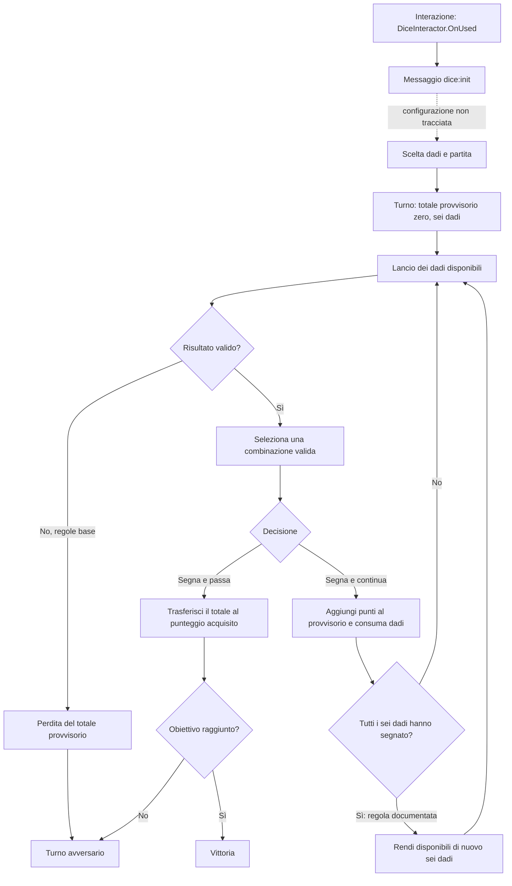

# Kingdom Come: Deliverance II — studio selettivo dei dadi

Data: 14 ottobre 2026. Obiettivo: comprendere le decisioni di rischio e confrontarle con l'esperimento «L'arte del rischio» di Manuscript. Nessuna nuova regola proposta o implementata.

## Esito e qualità delle evidenze

Il ciclo base è ricostruibile senza decompilare il gioco: tutorial distribuito, tabelle locali, uno script d'interazione e schermate documentate danno evidenze sufficienti per un modello decisionale. **Non è stata ricostruita la funzione nativa di punteggio.** Il risultato è un'analisi di artefatti e regole documentate, non una verifica completa dell'esecuzione.

La differenza decisiva rispetto a L'arte del rischio è la condizione di prosecuzione: KCD2 somma nuovi risultati validi al totale provvisorio; il prototipo richiede di migliorare strettamente il valore dell'opera completa, con un tetto molto vicino. Entrambi permettono di assicurare il risultato terminando il turno, ma offrono opportunità di crescita molto diverse.

Legenda usata nel rapporto:

- **L — locale:** contenuto verificato nei file installati; non garantisce che una mod o un ramo nativo non lo modifichi.
- **O — osservazione:** schermata del gioco pubblicata da terzi ed esaminata direttamente; non è una sessione giocata sulla build locale.
- **D — documentazione:** regola descritta da una fonte, senza traccia d'esecuzione locale.
- **M — modello:** conseguenza matematica sotto ipotesi esplicite.
- **I — interpretazione:** possibile implicazione progettuale, da provare con giocatori.

## 1. Installazione e architettura

Il collegamento `C:\Users\Davide\Desktop\KingdomCome - collegamento.lnk`, letto senza avviarlo, punta a:

`S:\Hydra Games\KCD-2 - SteamGG.NET\KCD-2 - SteamGG.NET\Bin\Win64MasterMasterSteamPGO\KingdomCome.exe`

Nel seguito **ROOT** indica `S:\Hydra Games\KCD-2 - SteamGG.NET\KCD-2 - SteamGG.NET`.

| Componente | Evidenza | Conclusione |
|---|---|---|
| Motore | [FAQ tecniche del publisher Plaion](https://playersupport.plaion.com/it/support/solutions/articles/10000003255-faq-tecniche); directory `Engine`, archivi e script locali coerenti | CryEngine; versione/fork esatto del motore non determinato |
| `Bin/Win64MasterMasterSteamPGO/KingdomCome.exe` | REA: PE32+, x86_64, machine `0x8664`, 6 sezioni, directory CLI assente; 1.525.760 byte | Eseguibile nativo, non assembly .NET |
| `Bin/Win64MasterMasterSteamPGO/WHGame.dll` | REA: PE32+, x86_64, 7 sezioni, CLI assente; 89.176.576 byte | Grande componente nativo del gioco; ILSpy non è il percorso adatto |
| `kcd_launcher.log` nella stessa directory | Caricamento di `WHGame`, creazione `GameStartup`, inizializzazione e avvio | Il piccolo EXE avvia un componente di gioco separato; non basta analizzare soltanto il launcher |
| `Data/Scripts.pak`, `Data/Tables.pak`, `Localization/English_xml.pak` | Directory ZIP leggibili; membri selezionati accessibili senza cifratura | Lua, XML e testi sono una via selettiva più economica del disassemblaggio globale |
| `WHGameArm.dll` | Presente, 107.039.232 byte | Inventariata soltanto; nessuna conclusione sulla sua architettura dal nome |

REA è connesso e ha risposto alle ispezioni. Il provider Ghidra risulta disponibile, versione **12.1.4**. Il formato nativo x64 è compatibile in linea di principio; non è stato importato né sottoposto ad autoanalisi l'intero `WHGame.dll`. La riuscita di una futura decompilazione selettiva non è quindi certificata da questa indagine.

Identità degli oggetti ispezionati da REA:

| File | SHA-256 | ID evidenza REA |
|---|---|---|
| KingdomCome.exe | `196ce02531260871ae4d25506429feb794e13707eefcafd59bddf627d9dbc5e1` | `ev_60988d8a05e83689c73055ada8af0a8dbf6f85d0860c002137bf1b382a73968f` |
| WHGame.dll | `6ca18dc333daa207b41ee18bc064c6341f21948c943e415b6dc6c528e1afa760` | `ev_fc155a4f9726d2fff6e367fbe48c0065e4260bae64fcc613f8a3ad2f6ea32c8e` |

`system.cfg`, riga 185, dichiara `wh_sys_version = "1.5.5"`. Il log storico `kcd.log` riporta `1.5.5-15315-release_1_5`, configurazione `MasterMasterSteamPGO`, e mod abilitate. Non ho certificato l'integrità dell'installazione rispetto a una distribuzione ufficiale né l'effetto delle mod. Le tabelle qui sotto provengono dagli archivi base indicati, non da una ricostruzione dell'ordine effettivo degli override.

**Cambio di metodo:** l'identificazione binaria resta affidata a REA; per le regole si usano letture in memoria di pochi membri `.pak`, tutorial e schermate. Nessun dump del codice nativo, nessuna estrazione massiva, nessuna esecuzione del gioco o aggiramento di protezioni.

## 2. Registro delle evidenze locali

I percorsi dei membri sono relativi all'archivio indicato. Le chiavi XML e i nomi delle funzioni sono riferimenti riproducibili più stabili dei numeri di riga.

| ID | Archivio / membro | Evidenza pertinente |
|---|---|---|
| L1 | `Data/Scripts.pak` → `Scripts/Entities/WH/Minigames/DiceInteractor.lua` | `GetActions`: verifica utente, disponibilità e `Minigame.CanUseMinigame`; espone l'interazione per giocare. `OnUsed`: invia `dice:init` tramite `XGenAIModule.SendMessageToEntity`, con `forceDialog(true)` |
| L2 | `Localization/English_xml.pak` → `text_ui_menus.xml` | `ui_helpoverlay_dice0_s0900`: sei dadi iniziali, selezione dei dadi validi, rilancio dei restanti, perdita dei punti del turno se manca un risultato valido, possibilità di terminare, corsa all'obiettivo |
| L3 | Stesso membro | `ui_helpoverlay_dice0_s0700`: scelta dei dadi dall'inventario; `s1500`, `s1600`, `s2700`: distinzione tra punti segnati, provvisori e selezione corrente |
| L4 | Stesso membro | `ui_helpoverlay_dice1_s1300`: raddoppio per ogni dado uguale oltre il terzo; `s1700`: testa del diavolo come jolly |
| L5 | Stesso membro | `ui_hint_dice_continue`, `ui_hint_dice_score_pass`, `ui_hint_dice_hold`, `ui_dice_bust`, `ui_hint_info_dice_stop`: comandi e segnalazioni di prosecuzione, incasso, selezione, fallimento e perdita della puntata abbandonando |
| L6 | Stesso membro | `ui_helpoverlay_dice2_s0200` e famiglie `dice3`, `dice4`, `dice5`: livelli dei distintivi ed effetti descritti |
| L7 | `Data/Tables.pak` → `Libs/Tables/item/item.xml` | Elementi `Die`: identificatori, `SideWeights`, `SideValues`, nomi UI e prezzi di configurazione |
| L8 | `Data/Tables.pak` → `Libs/Tables/rpg/rpg_param.xml` | Parametri `DiceGameTypeScore…`: obiettivi differenti per tipo di partita |

Hash SHA-256 dei membri principali, calcolati sui byte decompressi:

```text
DiceInteractor.lua
4a22ee0cd20281bb96f672c838aed49c74572cf0bab74ad5fefefe5b7a5ef561
text_ui_menus.xml
ab039edf01a8ea972101ca07ba98f121736a51f69a9cce0d002f43d4557dde5d
Libs/Tables/item/item.xml
8a16c71eb8e7d4afdff57674f95e495358f81fc11346897cb6b2b66a084f7876
Libs/Tables/rpg/rpg_param.xml
cbd846fa947a2c33a5fe4fee5cfffb1305f323e9d536b1a0c137c6799903a64a
```

L1 verifica l'ingresso nel minigioco, non il calcolo dei punti. Non attribuisco allo script logiche che non contiene. La presenza di ulteriori file quest non basta a ricostruirne le conseguenze.

## 3. Regole e ciclo ricostruito

### Punteggio base

**O:** lettura diretta della [schermata del tutorial: combinazioni](https://www.gamerguides.com/assets/media/17/376/kcd2_dice_rules-3d8e5ded.jpg), pubblicata nella guida Gamer Guides. Nessuna formula nativa decompilata.

| Risultato dello stesso lancio | Punti |
|---|---:|
| 1 singolo | 100 |
| 5 singolo | 50 |
| 1–2–3–4–5 | 500 |
| 2–3–4–5–6 | 750 |
| 1–2–3–4–5–6 | 1.500 |
| Tre 1 | 1.000 |
| Tre 2 / 3 / 4 / 5 / 6 | 200 / 300 / 400 / 500 / 600 |

Ogni uguale oltre il terzo raddoppia il gruppo: quattro 2 valgono 400, cinque 800, sei 1.600. Il jolly sostituisce un valore in una combinazione (O, L4). Non estendo automaticamente questa regola a ogni caso limite del jolly.

### Selezione, rischio e incasso

**L2:** il turno comincia con sei dadi. Dopo un risultato valido si scelgono dadi che segnano punti, quindi si termina il turno oppure si continua con quelli rimasti. Un lancio privo di punti annulla il guadagno provvisorio del turno. Arrivare prima all'obiettivo vince la partita.

**D:** i dadi già segnati non si combinano con lanci successivi; quando tutti e sei hanno segnato, diventano nuovamente rilanciabili. Il totale provvisorio resta esposto al fallimento anche dopo questo recupero. I punti incassati nei turni conclusi restano acquisiti. Fonte: [regole documentate](https://www.gamerguides.com/kingdom-come-deliverance-ii/guide/getting-started/tips-and-tricks/dice-rules-and-tips), paragrafi successivi alla tabella.

Per evitare ambiguità, «trattenere» un dado e «assicurare» punti sono decisioni diverse: il primo costruisce il guadagno ancora vulnerabile del turno, il secondo lo trasferisce al punteggio acquisito e cede la mano.

### Modello delle transizioni

Il diagramma combina il tutorial locale con la regola documentata del recupero dei sei dadi. Non rappresenta nomi di stati interni trovati nel binario.



Distintivi e jolly possono alterare il ciclo base: non sono stati inseriti nel diagramma come se ne fosse stato tracciato ogni ramo.

### Obiettivi, puntate e conseguenze

L8 contiene, tra gli altri: `DiceGameTypeScoreBeggar=1500`, `Wagoner=2000`, `Craftsman=3000`, `Novice=4000`, `Knight=5000`, `King=8000`, `Emperor=8000`. **Non esiste quindi un unico obiettivo di 4.000 deducibile da questi dati.** L'assegnazione concreta di ciascun tipo a ciascun incontro resta non verificata.

L5 avverte che abbandonare perde la puntata. Non ho verificato il flusso monetario completo: addebito iniziale, restituzione della posta, guadagno netto e premi di quest non sono ricostruiti. Vincere punti nel turno, vincere la partita e ricevere denaro sono tre eventi distinti.

## 4. Dadi speciali e distintivi

**L7:** questi sono dati effettivamente presenti, non probabilità misurate su lanci del gioco.

| Nome interno | ID | Pesi ordinati delle sei facce |
|---|---|---|
| `dieNormal` | `65ccc0cd-de18-4305-9d64-42bb3c6d8d30` | 1, 1, 1, 1, 1, 1 |
| `dieFavourable` | `bd819743-3e32-474e-8333-bebe92b16e98` | 6, 0, 1, 1, 6, 4 |
| `prepadeni_dieBarn` | `f8e3162a-dff1-4099-a60f-05be4e40f7ca` | 10, 1, 1, 1, 1, 1 |
| `dieDevil` | `9a9d9c0d-2c94-475d-ab72-75b8ced9ac05` | 1, 1, 1, 1, 1, 1 |

Nei primi tre casi `SideValues` è `0 1 2 3 4 5`; in `dieDevil` è `6 1 2 3 4 5`. L'associazione dell'indice speciale 6 al jolly è coerente con il tutorial e il nome del dado, ma non è stata seguita nel codice nativo.

**M:** normalizzando i pesi e associando gli indici ordinari alle facce 1–6, Favourable dà probabilità 1/3 a 1, 1/3 a 5 e zero a 2; il dado `prepadeni_dieBarn` dà 2/3 a 1 e 1/15 a ciascun'altra faccia. La tabella pubblica [INARA: dadi](https://inara.cz/kingdom-come-2/items-dice/) fornisce un riscontro per questi esempi. Non sono stati verificati il campionatore, l'indipendenza, l'effetto delle animazioni fisiche o eventuali modificatori ulteriori.

L6 descrive distintivi di stagno, argento e oro utilizzabili nelle partite del livello appropriato. Esempi selettivi dal tutorial:

- `ui_helpoverlay_dice3_s0800`: Fortune di stagno, rilancio di un dado una volta per partita.
- `ui_helpoverlay_dice3_s1800`: Resurrection di stagno, recupero dopo un lancio fallito una volta per partita.
- `ui_helpoverlay_dice4_s1800`: Warlord d'argento, aumento del 50% dei punti del turno una volta per partita.
- `ui_helpoverlay_dice5_s1600`: Priest d'oro, combinazione supplementare 1–3–5.

Sono **effetti dichiarati dai testi installati**, non testati dal vivo. Cambiano rispettivamente distribuzione degli esiti, costo del fallimento, valore del turno e insieme dei risultati validi. Non assumo che tutte le stringhe installate corrispondano a contenuti raggiungibili nella partita corrente.

## 5. Modello delle decisioni e convenienza del rischio

Lo stato utile per decidere comprende: punteggio acquisito proprio e avversario, obiettivo, totale provvisorio, risultati selezionabili, numero **e identità** dei dadi ancora disponibili, distintivi e utilizzi rimasti. Una soglia basata soltanto sui punti provvisori perde informazioni.

### Calcolo esatto limitato, non simulazione della partita

**M:** dadi normali uniformi e indipendenti, regole base, nessun distintivo. Considero la politica «un solo rilancio, poi incasso tutto ciò che segna». Indico con `T` il totale già provvisorio, con `p` la probabilità di fallimento e con `S` i punti aggiunti, posti a zero in caso di fallimento:

`Valore del rilancio = (1 − p) × T + E[S]`

`Vantaggio sul fermarsi = E[S] − p × T`.

Ho enumerato in memoria i 6, 36 e 216 esiti ordinati dei casi con uno, due e tre dadi. Nessuna nuova simulazione massiva; il campionatore del gioco non è coinvolto.

| Dadi normali rimasti | Esiti falliti / totali | Rischio | E[S] | Soglia T per il singolo rilancio |
|---|---:|---:|---:|---:|
| 1 | 4 / 6 | 66,67% | 25 | 37,5 |
| 2 | 16 / 36 | 44,44% | 50 | 112,5 |
| 3 | 60 / 216 | 27,78% | 86,8056 | 312,5 |

Per tre dadi, gli esiti senza 1 e 5 sono 64; quattro sono tris validi, lasciando 60 fallimenti. Il punteggio totale sui 216 esiti è 18.750: i singoli 1 e 5 più i premi dei tris, senza contare due volte gli stessi dadi.

Esempio concreto: dopo aver segnato tre 2 del primo lancio, `T=200` e restano tre dadi. Continuare una volta vale **231,25**, contro 200 assicurati. Dopo tre 5, `T=500` con gli stessi tre dadi: vale **447,92**, contro 500 assicurati. Qui la decisione cambia anche senza avversario o presentazione audiovisiva.

Queste non sono soglie ottimali universali: rinunciano al valore di ulteriori rilanci e del recupero di sei dadi. Un vantaggio positivo prova che esiste una continuazione migliore dell'incasso per l'obiettivo «punti medi» in quel modello; uno negativo non prova che ogni continuazione sia peggiore.

Con un solo Favourable, sotto la normalizzazione indicata, `p=1/3`, `E[S]=50`, soglia 150. Con `prepadeni_dieBarn`, `p=4/15`, `E[S]=70`, soglia 262,5. Il numero di dadi da solo non descrive quindi il rischio.

### Risposte alle cinque domande progettuali

1. **Quando fermarsi?** Un totale provvisorio elevato rispetto al rendimento dei dadi rimasti rende più costoso fallire. Incassare abbastanza per raggiungere l'obiettivo rende inutile esporsi ancora nel modello base. Restare con pochi dadi sfavorevoli è un altro incentivo; non basta dire «fermarsi dopo un bel lancio».
2. **Quando rischiare?** Esistono stati con vantaggio matematico positivo, come l'esempio 200/tre dadi. Recuperare tutti i dadi apre nuove opportunità; dadi favorevoli e protezioni cambiano il calcolo. Voler vincere la partita può richiedere scelte diverse dal massimizzare i punti del turno.
3. **Quali decisioni cambiano con la partita?** Quanto manca al traguardo, quanto è vicino l'avversario e quali risorse restano. La pressione dell'avversario è una conseguenza del modello a turni, non una politica dell'IA ricostruita. Non è stato calcolato un solver di vittoria contro avversari specifici.
4. **Probabilità o presentazione?** La probabilità produce un conflitto reale già nel modello numerico; la UI rende leggibile ciò che si rischia. Non è possibile attribuire percentuali della suspense all'una o all'altra senza confronto sperimentale.
5. **Cosa impedisce una strategia sempre uguale?** Gli stati richiedono azioni diverse, ma ciò non esclude una politica ottimale stabile condizionata allo stato. Equipaggiamento molto favorevole può ridurre la tensione; combinazioni e soglie apprese possono diventare routine. Non è dimostrato che il sistema resti interessante indefinitamente.

Un'ulteriore scelta è quanti risultati validi segnare: più punti immediati possono lasciare meno dadi per il prossimo lancio. L'eccezione decisiva è consumarli tutti, che li riattiva. Questo rende insufficiente la regola euristica «conserva sempre tutto ciò che vale punti» quando si vuole continuare.

## 6. Feedback: ciò che è osservato e ciò che manca

**O:** nella [schermata di selezione](https://www.gamerguides.com/assets/media/17/376/kcd2_dice_pick_3_of_a_kind-0ed9af10.jpg) tre 4 sono marcati in blu; il pannello mostra 400 selezionati, turno 0, punteggi acquisiti 0 e obiettivo 1.500. A destra compaiono selezione, prosecuzione, incasso e abbandono.

**L3–L5:** testi e tutorial distinguono punteggio acquisito, totale provvisorio, selezione e fallimento. Sono i presupposti per mostrare guadagno possibile e perdita possibile in modo separato.

**I:** il totale provvisorio visibile può rendere tangibile il costo di un altro tiro; l'aumento dei punti può gratificare e il recupero dei dadi può riaprire le aspettative. Sono ipotesi psicologiche, non proprietà emotive dimostrate dal codice.

Non ho osservato una partita continua, ascoltato suoni, misurato durata dei lanci o reazioni del giocatore. Non attribuisco suspense a pause, animazioni o commenti dell'avversario non esaminati. Le schermate verificano layout e stato, non il ritmo temporale.

## 7. Confronto con le 54.000 simulazioni di L'arte del rischio

Fonti locali: `experiments/arte_del_rischio/rules.lua`, `REPORT.md`, `games.csv`, `results.csv`, `measured-tables.md`, `exact-analysis.txt`. Letti in sola lettura. Verificati **54.000 record** in `games.csv` e **27 aggregati** in `results.csv`: 3 varianti × 9 politiche × 2.000 partite. Non sono simulazioni di KCD2 né un confronto sperimentale di divertimento.

| Aspetto | KCD2, modello base documentato | L'arte del rischio, regole effettive |
|---|---|---|
| Che cosa viene assicurato | Punti del turno, terminandolo | Ricompensa dell'opera, terminando il turno (`R.bank`) |
| Che cosa perde un fallimento | Totale ancora provvisorio | Opera del turno quando non migliora dopo un rischio (`R.settle`) |
| Risultati dei turni precedenti | Restano acquisiti | Opere conservate; attenzione: Tentazione sottrae punti dal totale |
| Condizione di prosecuzione | Un nuovo risultato valido aggiunge punti | Da opera completa il nuovo punteggio lordo deve essere strettamente maggiore |
| Crescita | Somma di risultati; recupero dei sei dadi | Miglioramento della stessa mano di quattro dadi; massimi 7 / 8 / 10 |
| Dadi trattenuti | Risultati che segnano; non costruiscono tris fra lanci | Pigmenti conservabili anche per una ricetta ancora incompleta |
| Limite operativo | Progressiva riduzione dei dadi, poi recupero | Due rilanci ordinari, più una Tentazione disponibile alle condizioni di `R.start` |
| Obiettivo | Arrivare prima dell'avversario alla soglia | Otto turni, almeno 25 punti e tutti e tre i tipi d'opera |
| Variazione del rischio | Identità dei dadi, punti, avversario, distintivi | Progetto, pigmenti, rilanci, cambio C, costo della Tentazione, tipi mancanti e soglia |

Il costo della Tentazione aumenta con gli usi nella partita ed è sottratto subito dal punteggio in `R.start`; il cambio C riduce di 2 la ricompensa tramite `R.reward`. Perciò «i risultati precedenti sono sicuri» nel prototipo significa che le opere non sono distrutte dal fallimento, **non** che il totale numerico non possa mai diminuire.

### Risultati già misurati

| Variante | Vittorie planner | Vittorie planner senza rischio | Vittorie planner con soglia | Rilanci da opera completa: planner / con soglia |
|---|---:|---:|---:|---:|
| A — scelta preventiva | 24,15% | 24,15% | 31,65% | 0 / 0 |
| B — scelta dopo il primo tiro | 43,80% | 43,80% | 46,90% | 0 / 3 |
| C — cambio a costo 2 | 38,65% | 38,65% | 44,15% | 0 / 2 |

Sono conteggi su 2.000 partite per cella, non percentuali dei soli stati che permettono un rischio. Gli aggregati mostrano che il pianificatore ordinario non sceglie mai il rischio da opera completa; vietarglielo non cambia vittorie e media. Il pianificatore con soglia lo fa in appena cinque casi complessivi nelle tre varianti; nessuno di quei cinque ha avuto successo. Questo campione minuscolo non stima la probabilità di successo di tale scelta.

Il miglioramento delle vittorie con la politica a soglia **non è attribuibile principalmente a quei cinque rischi**: in A aumenta senza alcun rilancio da opera completa. La funzione obiettivo cambia anche altre decisioni. Il punteggio medio scende da 17,32 / 24,04 / 21,67 a 16,84 / 23,23 / 21,19 mentre aumentano le vittorie: punti medi e probabilità di vincere non coincidono.

`exact-analysis.txt` riporta 56 stati completi canonici nei quali fermarsi prevale nel problema locale a punti, senza Tentazione. Esempio verificabile dalle regole: capolettera base da 3, due pigmenti estranei da rilanciare; ultimo tiro con premio 5 in 10 esiti, 7 in un esito, fallimento in 25 dei 36. Valore `57/36 = 1,5833`, contro 3 assicurati. La miniatura completa vale già il massimo 10: un ulteriore tiro non può soddisfare il miglioramento stretto.

Questo non prova che fermarsi sia sempre ottimo per vincere. Il controesempio già registrato è l'ottavo turno, tutti i tipi presenti e totale 21: assicurare 3 termina a 24 e perde; il rischio descritto può vincere con probabilità 11/36. A totale 22, assicurare vince certamente. La differenza di stato esiste anche in Manuscript, ma le simulazioni indicano che il rischio da opera completa emerge raramente nelle politiche esaminate.

### Limiti del confronto

Le simulazioni usano dadi uniformi indipendenti, semi 10001–12000 e politiche euristiche; non risolvono l'intera partita. Il planner con soglia è un controllo esplorativo, non una validazione su nuovi semi. Il piccolo campione fisico citato nel rapporto originale non certifica il modello probabilistico. Non confronto direttamente punteggi assoluti fra giochi con scale diverse.

KCD2 non dimostra che basterebbe aumentare i premi di Manuscript: cambia la struttura delle opportunità successive, non soltanto il numero scritto sul premio. Nessuna nuova regola viene proposta qui.

## 8. Implicazioni per Manuscript, separate dalle evidenze

1. **Evidenza:** in KCD2 un risultato incassabile può lasciare una prosecuzione con valore positivo; nelle simulazioni del prototipo le opere complete sono quasi sempre fermate. **Principio da valutare:** misurare quante decisioni di rischio sono davvero competitive negli stati raggiunti, distinguendo preparazione incompleta e lavoro già riuscito.
2. **Evidenza:** segnare dadi modifica punti e disponibilità del tiro seguente; il recupero totale cambia nuovamente le possibilità. **Principio da valutare:** quando giudichiamo una scelta artistica, esaminare anche ciò che rende possibile dopo, oltre al premio immediato. Non implica copiare combinazioni o distintivi.
3. **Evidenza:** UI e modello separano acquisito, provvisorio e selezione; le simulazioni distinguono massimizzazione dei punti e vittoria. **Principio da valutare:** rendere leggibili posta a rischio e obiettivo concreto, poi osservare se il giocatore cambia decisione e comprende la conseguenza. Suspense e gratificazione richiedono una prova osservata.

## 9. Punti ancora sconosciuti e riproducibilità

- Non individuati indirizzi o nomi delle funzioni native che calcolano punteggio, lancio, IA e pagamento. Nessuna pretesa di ricostruzione binaria di questi rami.
- Nessuna verifica locale di RNG, equipaggiamento avversario, eventuale adattamento o comportamento «truccato» dell'IA. Non assumo che l'avversario bari.
- Non coperti tutti i casi limite: jolly multipli, interazioni fra distintivi, combinazioni sovrapposte, momento esatto del controllo di vittoria e opzioni specifiche di quest.
- Non risolti override delle mod e differenze fra la build locale 1.5.5, gli screenshot e versioni successive.
- Nessuna misura empirica della suspense; la presentazione è stata osservata soltanto in due immagini documentate.

Per ripetere l'ispezione bastano il collegamento, i due PE identificati e i membri ZIP L1–L8. Per ripetere i calcoli con al massimo tre dadi si enumerano tutti gli esiti in `{1,…,6}^n`, si assegnano 100 ai singoli 1 e 50 ai singoli 5, sostituendo il punteggio con quello del tris quando tutti e tre coincidono. Si contano gli esiti da zero e si sommano i premi: i denominatori e i totali sopra permettono una verifica indipendente.

Un'eventuale prosecuzione tecnica dovrebbe partire da riferimenti mirati alle stringhe UI e alle API dei dadi nel modulo nativo, con un budget esplicito, non dall'autoanalisi indiscriminata del gioco. Per il quesito progettuale, una breve registrazione controllata di una partita normale e una con dadi speciali colmerebbe prima il limite sull'esperienza temporale.

L'unico file del progetto scritto da questa indagine è questo rapporto. Nessun codice o asset commerciale è stato esportato per il riutilizzo; giochi, simulazioni e codice di Manuscript sono rimasti invariati.
