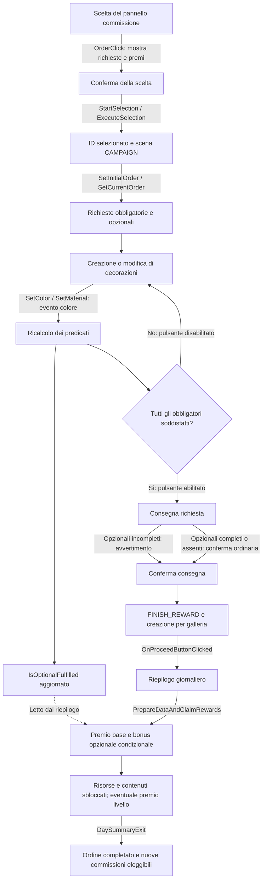

# Scriptorium — rapporto di reverse engineering

Data: 14 ottobre 2026. Stato attuale: fase 2 proseguita con ilspycmd 11.1; ricostruito staticamente il ciclo di selezione, modifica cromatica, verifica, consegna e ricompensa. Le sezioni iniziali conservano la cronologia della fase 1 e dei precedenti impedimenti, ora superati con l'alternativa autorizzata. I risultati aggiornati sono nella sezione «Fase 2 — risultati verificati».

## Esito

REA legge correttamente il formato del gioco. Ghidra 12.1.4 è disponibile per il componente nativo; la logica applicativa va cercata anzitutto negli assembly Unity/Mono. La disponibilità dei metadati è verificata. **Rettifica emersa in fase 2:** il provider managed disponibile non offre selezione dei metodi prima della lettura del CIL; la compatibilità del formato non dimostra quindi la fattibilità dell'indagine selettiva richiesta attraverso questa API.

## Architettura ed evidenze tecniche

Radice del gioco: `S:\Scriptorium Master of Manuscripts`.

| ID | Evidenza verificata | Fonte riproducibile |
|---|---|---|
| T1 | Server REA connesso: `rea-agents` 6.4.0, client `codex-mcp-client`; Ghidra disponibile | `binary_session({})`, campi `server_identity` e `analysis_provider_candidates` |
| T2 | Ghidra 12.1.4 in `C:\Users\Davide\Desktop\ghidra_12.1.4_PUBLIC`; headless e decompilatore Windows x64 trovati; JDK 25.0.4.1 accettato | Diagnostica del provider Ghidra in T1 |
| T3 | S: è `Fixed`, `NTFS`, `IsReady=True`; EXE presente, 666.624 byte | `[System.IO.DriveInfo]::new('S:\')`; `Get-Item` sul percorso fornito |
| T4 | EXE PE32+, x86-64, machine `0x8664`, 7 sezioni, senza directory CLI | `inspect_managed_artifact` sull'EXE; Evidence E1 |
| T5 | Risorsa versione EXE: `2022.3.62f2 (7670c08855a9)` | `Get-Item ...\Scriptorium.exe`, proprietà `VersionInfo.ProductVersion` |
| T6 | Presenti `UnityPlayer.dll` (31.100.840 byte), `MonoBleedingEdge`, `Scriptorium_Data\Managed`, `Assembly-CSharp-firstpass.dll` (189.440 byte) | Inventario immediato delle directory; nessuna scansione ricorsiva del gioco |
| T7 | `Assembly-CSharp.dll`: 1.981.440 byte, CIL, Unity/Mono, AnyCPU, flag `il-only`; metadati completi, nessun problema segnalato | `inspect_managed_artifact` sull'assembly; Evidence E2 |
| T8 | EXE accettato da `open_binary` con `provider_id=ghidra`; binding effettivo Ghidra 12.1.4 | `binary_session` successivo: profilo `249564812a8d83b9b3f461098fc485ccde60c516d4497547a124081c91d654bf` |

E1: `ev_1cd39a4709534819e5090e98eff104b97e8a63b96f3f9547703973b997fb438b`.

- File: `S:\Scriptorium Master of Manuscripts\Scriptorium.exe`.
- SHA-256: `78dc5db3dbae3fca6311327d0327b80421f493d05a8e4dc3e3d2e8cd36569e66`.
- Classificazione REA: `not-managed`; assenza di CIL nell'EXE non implica assenza di qualsiasi logica nativa.

E2: `ev_3407a5953e8b90a6b0ebdeef322b0ef245aced7d4f34930c7ebbb3fe3912ec3e`.

- File: `S:\Scriptorium Master of Manuscripts\Scriptorium_Data\Managed\Assembly-CSharp.dll`.
- SHA-256: `57bd30edf5df0d5dce9dc527ef78444294ad2d1d680de424621a781880c72849`.
- Header CLI a offset file 520; flag architetturali a offset 536.
- Identità assembly: `Assembly-CSharp`, versione `0.0.0.0`, token `0x20000001`, riga a offset 1.245.810.
- MVID: `81ab3e6d-9a54-4015-bc74-7bf334872dfd`.
- Riferimento `UnityEngine.CoreModule`: token `0x23000002`, riga a offset 1.245.866.
- Tabelle: 1.893 TypeDef e 11.541 MethodDef. Sono conteggi dei metadati, non funzioni decompilate né meccaniche identificate.
- AnyCPU è derivato dai flag CLI: il campo PE machine x86 dell'assembly non rende il gioco a 32 bit. Il processo di ingresso è x64.

L'inventario managed non carica l'assembly, non esegue codice e non decompila C#. Gli ID identificano le evidenze della sessione REA; hash, offset e chiamate sopra permettono di ripetere i controlli anche senza quella sessione.

## Compatibilità Windows e disco

Il provider dichiara un supporto Windows P0 sperimentale per applicazioni e DLL PE native x86/x64, con target e runtime su NTFS locale, Windows 10 o successivo e addon nativo Windows x64 corrispondente. Esclude target managed dal percorso Ghidra e impone controlli nativi sui percorsi.

S: soddisfa il requisito osservabile di volume locale NTFS. L'apertura dell'EXE con Ghidra è riuscita, ma non è stata richiesta una funzione decompilata: questo non certifica il successo di ogni operazione futura. I controlli di ammissione e la disponibilità del provider non equivalgono a una prova completa del decompilatore.

Il primo tentativo di interrogare il volume con `Get-Volume` ha incontrato una risorsa CIM non disponibile; la lettura tramite `System.IO.DriveInfo` è riuscita senza elevazione.

Il parser managed REA ha già letto con successo l'assembly sul disco S:. L'esclusione dei managed dal provider Ghidra non equivale a incompatibilità dell'intero REA.

## EXE, motore e contenitori della logica

**Verificato:** build Unity/Mono, EXE nativo x64 e assembly CIL separato. La versione riportata dall'EXE è Unity 2022.3.62f2.

**Inferenza forte:** `Scriptorium.exe` svolge il ruolo di bootstrap del player Unity e `Assembly-CSharp.dll` è il primo candidato per la logica specifica del gioco. Dimensioni, versione, struttura di distribuzione e riferimenti managed sostengono questa lettura.

**Non verificato:** che l'EXE sia esclusivamente un launcher senza alcuna logica propria. Non sono stati esaminati entry point, import, chiamata a UnityMain o flusso di avvio. Non è dimostrato quali metodi implementino le commissioni, né se tutte le loro regole risiedano nell'assembly principale.

`Assembly-CSharp-firstpass.dll` è una dipendenza presente e referenziata dall'assembly principale, ma il suo contenuto non è stato analizzato. `UnityPlayer.dll` è il candidato runtime del motore; la presenza non descrive da sola le sue funzioni interne.

`Scriptorium_Data\data.unity3d` misura 2.326.486.934 byte. Il contenuto non è stato aperto o estratto: scene, dati e risorse eventualmente necessari restano da identificare. Non è giustificata un'estrazione integrale per questa indagine.

## Metodo proposto per la fase 2

1. Ricerca limitata nei metadati di `Assembly-CSharp.dll` dei tipi relativi a commissioni, pagine, decorazioni e consegna. I nomi saranno indizi, non prove del comportamento.
2. Selezione di pochi metodi e campi; lettura del CIL con token, offset, riferimenti e condizioni di salto per seguire una singola commissione.
3. Tracciamento circoscritto: rappresentazione della richiesta → modifiche alla pagina → validazione → valutazione → ricompensa e stato successivo.
4. Consultazione di dati serializzati soltanto se un riferimento concreto li rende necessari; nessuna estrazione estesa senza approvazione.
5. Se il CIL o la ricostruzione REA risultassero insufficienti, fermarsi e proporre ILSpy su tipi/metodi selezionati. Ghidra resta utile solo per eventuali confini nativi motivati dalle evidenze.

Non è stata avviata la fase 2. Nessuna decompilazione batch o estrazione del pacchetto; nessuna esecuzione del gioco. La sessione nativa aperta per verificare il binding è stata chiusa con `close_binary({})`.

## Meccaniche ricostruite e aspetti non verificati

| Domanda | Stato |
|---|---|
| Rappresentazione di una commissione | Non indagata; tipi e campi da identificare |
| Condizioni di completamento | Non indagate |
| Costruzione delle decorazioni | Non indagata |
| Registrazione delle modifiche alla pagina | Non indagata; nessuna conclusione su salvataggi o undo |
| Valutazione del lavoro | Non indagata; nessuna formula attribuita al gioco |
| Ricompense e conseguenze | Non indagate |
| Decisioni e possibilità successive | Da ricostruire e poi confrontare con il gameplay |
| Feedback, gratificazione e varietà | Non osservati durante il gioco |

La verifica tecnica non consente valutazioni sul divertimento, sulla leggibilità delle regole o sulla frequenza delle ricompense. Serviranno osservazione del gameplay e confronto con le regole ricostruite.

## Cinque principi progettuali provvisori

Questi sono criteri di ricerca per il nostro gioco, non risultati ricavati dal titolo commerciale. Andranno rivisti dopo le fasi 2 e 3.

1. **Vincoli leggibili, soluzioni molteplici:** una commissione può indicare l'obiettivo lasciando libertà nella composizione della pagina.
2. **Scelte con conseguenze comprensibili:** materiali, tempo e impegni possono cambiare le possibilità successive; la conseguenza deve essere percepibile prima della scelta.
3. **Feedback collegato al gesto:** mostrare che cosa cambia quando il giocatore interviene sulla pagina e distinguere avanzamento, qualità e gusto del committente.
4. **Varietà da combinazioni significative:** combinare esigenze, strumenti e vincoli che richiedano strategie diverse, verificando che non siano soltanto variazioni cosmetiche.
5. **Ricompense che aprono nuove decisioni:** affiancare al premio immediato nuove possibilità espressive o nuovi incarichi, verificandone l'effetto con prove di gioco.

## Confini rispettati

Nessuna modifica agli eseguibili originali, nessun aggiramento di protezioni, nessuna copia di codice o risorse nel progetto. L'unico artefatto aggiunto al workspace è questo rapporto; il gioco Manuscript/Scriptorium non è stato modificato.

## Fase 2 — verifica della selettività e arresto motivato

La richiesta approvata prevede ricerca nei metadati e lettura del CIL soltanto dei metodi pertinenti. Prima di invocare il parser dei membri è stato verificato il contratto effettivamente disponibile, quindi il codice installato di REA. Non è stato analizzato il CIL dell'assembly commerciale in questa fase.

### Limite verificato del provider

Il tool `inspect_managed_members` accetta esclusivamente `path`, opzionale. Non espone filtri per nome, tipo, token, intervallo di metodi o una modalità metadata-only. La CLI `inspect-managed-members` inoltra lo stesso percorso alla stessa operazione senza opzioni selettive.

Non si tratta soltanto di un output molto ampio: l'implementazione legge i corpi prima di produrre il risultato. Filtrare il JSON dopo la chiamata non rispetterebbe il vincolo sulla lettura selettiva del CIL.

Evidenze locali del funzionamento di REA (ispezione testuale, non nuove Evidence REA sul gioco):

| Riferimento | File nella distribuzione installata REA 6.4.0 | Osservazione |
|---|---|---|
| R1 | `dist/contracts/managed/managedToolContracts.js`, righe 8–15 e 36–41 | Schema strict con il solo parametro `path`, riutilizzato per `inspect_managed_members` |
| R2 | `dist/dotnet/ManagedMemberInspector.js`, funzione `inspectManagedMembersBytes` | Invoca `parseMethods` con bytes, layout, pe e ranges, senza selezione di metodi |
| R3 | `dist/dotnet/ManagedMemberRows.js`, righe 68–104 | `parseMethods` percorre le righe della tabella MethodDef; alla riga 95 invoca `methodBody` per ciascuna riga letta con successo |
| R4 | `dist/cli/managedCommands.js`, righe 29–34 | La CLI inoltra `inspect_managed_members` con opzioni vuote |

Radice assoluta dei quattro file: `C:\Users\Davide\AppData\Local\npm-cache\_npx\af752b90495482d7\node_modules\rea-agents`.

La tabella MethodDef di questo assembly contiene 11.541 righe (E2). L'operazione tenterebbe quindi di ispezionare tutti quei metodi, nei limiti del decoder. Non equivale a decompilarli tutti in C#, ma supera comunque il vincolo esplicito di analizzare il CIL soltanto dei metodi pertinenti. La chiamata **non è stata effettuata**.

`inspect_managed_artifact`, già usato in fase 1, fornisce identità, riferimenti e attributi, ma non l'inventario dei nomi dei tipi e metodi necessario a questo passaggio. `inspect_analysis_view` legge risultati già prodotti: non rende selettiva la produzione iniziale e non è un'alternativa a tale limite.

### Stato dei quattro passaggi richiesti

| Passaggio | Esito effettivo |
|---|---|
| Ricerca nei metadati e lista ristretta | Non eseguita tramite il tool dei membri, per evitare la lettura generalizzata dei corpi; nessuna classe candidata presentata come verificata |
| Analisi dei metodi pertinenti | Non avviata; firme, token e condizioni del ciclo ancora sconosciuti |
| Diagramma del ciclo verificato | Non producibile: la sequenza fornita dall'utente è l'obiettivo di ricerca, non una sequenza dimostrata dal codice |
| Confronto con Manuscript | Rinviato come richiesto, perché dipende dalla ricostruzione; nessuna analisi o modifica del progetto effettuata |

Restano sconosciuti i criteri di completamento, la persistenza delle modifiche, costi e penalità, l'incidenza delle decorazioni sulla valutazione e l'effetto delle ricompense sulle possibilità successive. Non sono stati dedotti dai nomi né dall'architettura Unity.

### Alternativa circoscritta proposta

Per mantenere il vincolo di selettività, cambiare strumento per i passaggi non supportati da REA:

1. Leggere soltanto le tabelle dei metadati con un lettore PE/CLI, senza chiamare il decoder dei corpi e senza caricare l'assembly nel runtime. Cercare i termini richiesti e registrare nomi, firme, token, tipi dichiaranti e relazioni dichiarate.
2. Costruire la lista ristretta sulla base di quei dati, marcandola come insieme di candidati.
3. Usare ILSpy soltanto sui metodi selezionati e sulle dipendenze direttamente necessarie, registrando token e offset CIL insieme alle condizioni osservate. Non esportare l'intero progetto decompilato.
4. Mantenere come ancoraggio l'identità SHA-256/MVID verificata da REA; distinguere le ulteriori evidenze del lettore/ILSpy dalle Evidence REA. Non attribuire a REA risultati ottenuti con altri strumenti.
5. Soltanto dopo la ricostruzione, leggere le parti pertinenti di Manuscript e confrontare il collegamento tra dadi, scelte artistiche, realizzazione e conseguenze. Nessuna modifica del gioco e nessuna nuova meccanica complessa in questa fase.

Disponibilità e versione di ILSpy non sono state verificate; nessun software è stato installato. Non è ancora possibile indicare nomi esatti di metodi da aprire in ILSpy senza inventarli: questa selezione richiede prima il punto 1.

L'arresto dipende dalla granularità dell'API disponibile e dal vincolo dell'utente, non da DRM, incompatibilità del disco o rifiuto di autorizzazione. Per riprendere occorre accettare questa alternativa selettiva oppure disporre di un provider REA che esponga filtri prima della decodifica dei corpi.

## Proseguimento approvato con ILSpy — preparazione

Il passaggio al lettore selettivo ILSpy/ilspycmd è stato approvato dall'utente. Prima dell'inventario è stata verificata la disponibilità degli strumenti:

- `Get-Command ilspycmd` non restituisce un eseguibile nel PATH; neppure il percorso convenzionale `C:\Users\Davide\.dotnet\tools\ilspycmd.exe` risulta presente.
- Nessun candidato ILSpy è emerso nei controlli delle directory immediate del Desktop e di Program Files o nella ricerca di file ilspy/manifest dotnet-tools nel workspace. Questi controlli non sono una ricerca esaustiva su tutti i dischi.
- `dotnet` è disponibile in `C:\Program Files\dotnet\dotnet.exe`.
- `dotnet --list-runtimes` riporta `Microsoft.NETCore.App 9.0.20` e `Microsoft.WindowsDesktop.App 9.0.20`.
- `dotnet --list-sdks` non restituisce SDK; `dotnet tool list --global` fallisce esplicitamente perché non è disponibile un SDK.
- La distribuzione ilspycmd 11.1.0.9782 pubblicata su [NuGet](https://www.nuget.org/packages/ilspycmd/11.1.0.9782) ha target .NET 10. Il runtime 9 rilevato non soddisfa quel requisito.

Impedimento attuale: ilspycmd non trovato e toolchain .NET insufficiente per installare/eseguire quella distribuzione con il percorso standard. Non è stato installato nulla, rispettando la richiesta esplicita di ottenere prima autorizzazione.

Proposta concreta: predisporre SDK .NET 10 e ilspycmd in una directory dedicata fuori dal progetto e dall'installazione commerciale, ad esempio `C:\Users\Davide\AppData\Local\ScriptoriumAnalysis`, utilizzandoli tramite percorsi espliciti senza cambiare il PATH globale. La compatibilità effettiva andrà confermata con l'esecuzione di `ilspycmd --version` prima dell'inventario. Quindi inventario dei tipi e ricostruzione di 3–5 classi centrali, senza esportazione integrale del sorgente.

In attesa dell'autorizzazione all'installazione: nessuna nuova classe, condizione o transizione di gameplay è stata verificata. Il confronto progettuale resta subordinato a quella ricostruzione.

## Fase 2 — risultati verificati

### 1. Installazione isolata, identità e perimetro

Autorizzazione ricevuta per `C:\Users\Davide\AppData\Local\ScriptoriumAnalysis`, di seguito **A**. SDK, tool, cache NuGet, CLI home, download e file temporanei di questa analisi sono stati indirizzati sotto A. Nessuna modifica intenzionale al PATH globale, al registro, alle installazioni .NET esistenti o agli originali del gioco; non è stata richiesta elevazione amministrativa. Le autorizzazioni dell'esecutore per scrivere fuori dal workspace non sono elevazione amministrativa.

- SDK installato: **10.0.402**, archivio Windows x64 estratto in `A\sdk`.
- Fonte: [metadati Microsoft .NET 10](https://dotnetcli.blob.core.windows.net/dotnet/release-metadata/10.0/releases.json); archivio `https://builds.dotnet.microsoft.com/dotnet/Sdk/10.0.402/dotnet-sdk-10.0.402-win-x64.zip`.
- SHA-512 dell'archivio confrontato con i metadati Microsoft e coincidente: `ae4fd528cb7e9f6af6aaf7de36715a69f761f183744f1bb3025d19f5a92447090ec561410e46266c1d10a63781ed6f3de771760bc76c876d87daabc367b898cd`.
- Tool installato: **ilspycmd 11.1.0.9782**; motore dichiarato da `--version`: **ICSharpCode.Decompiler 11.1.0.9782**. Fonte: [pacchetto NuGet](https://www.nuget.org/packages/ilspycmd/11.1.0.9782); configurazione NuGet isolata con il solo feed `https://api.nuget.org/v3/index.json`.
- Il tool ha eseguito correttamente `--version`, `--help`, inventari ed estrazioni selettive C#.
- SHA-256 dell'assembly ricalcolato e uguale all'Evidence REA E2: `57bd30edf5df0d5dce9dc527ef78444294ad2d1d680de424621a781880c72849`. Rimangono validi identità e MVID della fase 1. Le nuove osservazioni sono **ILSpy/ispezione locale**, non nuove Evidence REA.

L'inventario richiesto `-l 'c,i,s'` non ha prodotto voci in questa build. È stato sostituito da tre chiamate `-l c`, `-l i`, `-l s`: rispettivamente **1.608 classi, 14 interfacce, 154 strutture**, comprendenti tipi generati dal compilatore. Le tabelle `TypeDef` e `MethodDef` sono state lette con `--dump-table ... --json`, esclusivamente per associare nomi, token e RVA: la lettura di tutte le righe dei metadati non è decompilazione di tutti i corpi.

Output conservati esclusivamente in `A\evidence`: inventari `types-c.txt`, `types-i.txt`, `types-s.txt`, `TypeDef.json`, `MethodDef.json`; otto estrazioni di classe e **42 estrazioni di singolo metodo**. Le cinque classi iniziali sono Order, OrdersManager, DrawingOrderChecker, DrawingProgressSaver e OrderPayment_SO; le tre dipendenze di valutazione sono OrderDemand_SO, StandardOrderDemand e DrawForOrderDemandsInfo. Gli altri componenti sono stati seguiti per singoli metodi direttamente pertinenti. Non è stato esportato un progetto sorgente decompilato.

**Incidente di perimetro documentato:** una verifica `-il -m 0x06000DE3` ha ignorato la selezione del membro e prodotto un dump IL esteso di 18.911.847 byte. Quindi non sarebbe corretto affermare che ogni operazione del tool sia rimasta selettiva. Sono state viste soltanto le prime righe, sufficienti a rilevare l'errore; il dump non è stato usato per cercare altre funzioni o fondare conclusioni. Il solo file `A\evidence\il-0x06000DE3.txt` è stato eliminato e ne è stata verificata l'assenza. Non è stata ripetuta la modalità `-il`. La ricostruzione seguente deriva dalle estrazioni C# selettive e dai token dei metadati; non si rivendicano offset IL verificati.

### 2. Classi candidate: elenco ristretto

I nomi seguenti sono completi: queste dieci classi sono nel namespace globale. I termini dominanti sono **Order, Demand, DraggableObject, Drawing, Payment**; alcuni tooltip sono in polacco. Non è necessario forzare il termine Manuscript, assente dai nomi centrali identificati.

| Classe | TypeDef | Rilevanza verificata dopo l'esame |
|---|---|---|
| `Order` | `0x02000169` | Dati della commissione: ID, cliente, richieste, pagamenti base/opzionale, pergamene, prerequisiti e prestigio |
| `OrdersManager` | `0x02000152` | Selezione corrente, generazione degli incarichi disponibili e registrazione di fine giornata |
| `DrawingOrderChecker` | `0x020000AE` | Requisiti obbligatori/opzionali, ricalcolo e conferma della consegna |
| `StandardOrderDemand` | `0x02000177` | Conteggio filtrato per categoria, colore/materiale e confronto con una quantità |
| `DrawForOrderDemandsInfo` | `0x02000168` | Dati passati ai valutatori, separando oggetti inseriti e oggetti predefiniti |
| `ObjectCreator` | `0x020000C6` | Istanzia una decorazione, imposta posizione, colore/materiale e scala, registra il comando |
| `DrawingScreenManager` | `0x020000B3` | Apertura della commissione, stato FINISH_REWARD e serializzazione della creazione |
| `OrderPayment_SO` | `0x02000179` | Descrive risorse e contenuti sbloccabili; non applica autonomamente i premi |
| `DaySummaryManager` | `0x0200015E` | Calcola e applica i premi; gestisce l'uscita verso il giorno successivo |
| `DrawingProgressSaver` | `0x020000B2` | Autosalvataggio/salvataggio richiesto e chiamate ai dati di pagina e commissione |

Dipendenze seguite soltanto dove necessario: SelectionGroup, SpritableSpriteRenderer, DrawingOrderUI, OrderSelectionManager, ResourceManager, ObjectLimiter; componenti SaveSystem, CommandSystem, DrawingScreen.Serialization e RewardAnimation citati nel registro sotto. La lista candidata resta di dieci classi; le dipendenze non rappresentano ulteriori sottosistemi esplorati integralmente.

### 3. Registro dei metodi e delle evidenze

Tutti i metodi appartengono a **Assembly-CSharp.dll**, identificato dall'hash E2. I token sono locali a questa build. Le firme riportano tipi e parametri rilevanti; gli argomenti opzionali mantengono il tipo, ma non sempre il valore di default. I file di singolo metodo sono `A\evidence\method-<token>.cs`; i metodi delle otto classi estratte si trovano nel corrispondente `<Classe>.cs`. `MethodDef.json` conferma nome, token e RVA; `TypeDef.json` associa l'intervallo MethodList al tipo dichiarante.

**Certezza:** «alta statica» significa assegnazioni, chiamate e condizioni leggibili nell'output selettivo ILSpy; non esecuzione osservata né recupero del sorgente originale. Configurazioni Unity, callback serializzate e dati salvati non sono stati estratti.

| Metodo e firma | Token | Condizione/transizione e riferimenti | Certezza |
|---|---|---|---|
| `OrderSelectionManager.OrderClick(OrderSelectionPanel): void` | `0x06000CA6` | Memorizza il pannello; mostra titolo, progresso e pagamenti base/opzionale | Alta statica |
| `OrderSelectionManager.ExecuteSelection(): void` | `0x06000CAE` | Se un disegno è in corso chiama ClearWithSave; seleziona l'ordine del pannello, salva orderSaveData, emette ActiveOrderChangedSignal, apre CAMPAIGN | Alta statica |
| `DrawingScreenManager.SetInitialOrder(): void` | `0x06000507` | Usa SelectedOrderID; in assenza usa l'ordine biblioteca; chiama SetCurrentOrder | Alta statica |
| `DrawingOrderChecker.SetCurrentOrder(Order,bool,bool): void` | `0x060004D7` | Con forceSet o ordine corrente nullo, e ordine diverso: aggiorna ordine, richieste, pergamena, UI e valutazione iniziale | Alta statica |
| `DrawingOrderChecker.SetCurrentDemands(): void` | `0x060004DA` | Partiziona currentOrder.Demands secondo il flag Optional | Alta statica |
| `ObjectCreator.CreateObject(DraggableObject,ColorInfo,bool): DraggableObject` | `0x0600062C` | Crea un'istanza, applica posizione, colore/materiale e scala; percorso non-drag registra CommandCreate ed emette OnDraggableObjectCreated | Alta statica |
| `SelectionGroup.SetColor(UnityEngine.Color): void` | `0x0600082C` | Modifica i renderer della selezione ed emette OnSelectedObjectsColorChanged | Alta statica |
| `SelectionGroup.SetMaterial(MaterialData,UnityEngine.Color): void` | `0x0600082D` | Applica materiale/colore agli oggetti selezionati ed emette lo stesso evento | Alta statica |
| `SpritableSpriteRenderer.SetColorImpl(Color,bool,bool): void` | `0x06000750` | Per cambio intenzionale rimuove il materiale personalizzato; aggiorna CurrentColor. L'highlight ha un ramo distinto | Alta statica |
| `DrawForOrderDemandsInfo..ctor(List<DraggableObject>,ResourceManager,TextEditorManager)` | `0x06000D62` | Separa IsParchmentPredefined; acquisisce numero caratteri e ResourceManager | Alta statica |
| `StandardOrderDemand.GetCurrentOrderDemandProgressQuantity(DrawForOrderDemandsInfo): int` | `0x06000DE2` | Filtra per categoria e colori/materiali ammessi, restituisce il conteggio | Alta statica |
| `StandardOrderDemand.GetDemandProgress(DrawForOrderDemandsInfo): Structs.OrderDemandProgress` | `0x06000DE3` | Confronta conteggio e Quantity attraverso Helpers.Operate | Alta statica |
| `Helpers.Operate(int,int,Enums.Operation): bool` | `0x06000927` | MORE_THAN: maggiore stretto; LESS_THAN: minore stretto; EQUAL: uguaglianza; altri valori: falso | Alta statica |
| `DrawingOrderChecker.OnEnable(): void` | `0x060004C7` | Collega i cambiamenti di lista, ordinamento, colore e trasformazione al ricalcolo; sottoscrive chiusura editor testo | Alta statica |
| `DrawingOrderChecker.CheckIfCurrentDemandsFulfilled(bool): void` | `0x060004CC` | Ignora SANDBOX; ricalcola due gruppi, salva flag opzionali e conteggio soddisfatti; aggiorna UI, segnali e popup | Alta statica |
| `DrawingOrderUI.UpdateUI(bool,Order,List<FulfillmentData>,bool): void` | `0x060004E1` | confirmFulfill.interactable segue il risultato dei requisiti obbligatori | Alta statica |
| `DrawingOrderChecker.FulfillOrder(): void` | `0x060004D1` | Se esistono opzionali incompleti mostra avvertimento; altrimenti conferma ordinaria, eventualmente saltabile da impostazione | Alta statica |
| `DrawingOrderChecker.OnConfirmOrder(): void` | `0x060004D2` | Chiama ConfirmOrderAndGoToRewardScreen, poi ripulisce lo stato del checker | Alta statica |
| `DrawingScreenManager.GoToRewardScreen(Order,bool): void` | `0x0600050A` | Imposta FINISH_REWARD, salva creazione e avvia presentazione del risultato | Alta statica |
| `DrawingScreenManager.SavePlayerCreation(Order,bool): void` | `0x06000511` | In campagna serializza oggetti/testi per galleria; per IsFragmentOrder registra anche creazione concatenata | Alta statica |
| `RewardAnimation.RewardAnimationManager.OnProceedButtonClicked(): void` | `0x06001D72` | Nel ramo campagna salva thumbnail/preview e apre il riepilogo giornaliero | Alta statica |
| `DaySummaryManager.PrepareDataAndClaimRewards(): void` | `0x06000C32` | Somma risorse base; se opzionali soddisfatti aggiunge quelle opzionali tranne PRESTIGE; chiama ClaimOrderRewards; rileva cambio livello | Alta statica |
| `DaySummaryManager.ClaimOrderRewards(): void` | `0x06000C33` | Accredita risorse positive delle voci daySummaryResources; applica oggetti, arredi, ispirazione e fiore del pagamento base | Alta statica |
| `DaySummaryManager.ClaimNewLevelRewards(): void` | `0x06000C35` | Applica risorse e contenuti configurati nel premio del livello raggiunto | Alta statica |
| `DaySummaryManager.DaySummaryExit(): void` | `0x06000C36` | Esegue azioni nuovo giorno, gestione ordini e challenge; passa a sequenza sogno o finale | Alta statica |
| `OrdersManager.EndDayOrdersManagment(): void` | `0x06000AD4` | Chiama FulfillSelectedOrder, rigenera selezionabili, emette OrderFinishedSignal | Alta statica |
| `SaveSystem.OrdersSave.FulfillSelectedOrder(bool): void` | `0x06002162` | Aggiunge SelectedOrderID ai completati; ramo biblioteca aggiorna contatore; azzera selezione | Alta statica |
| `SaveSystem.DrawableObjectsData.AddDrawObject(DraggableObject): bool` | `0x06001FE7` | Se l'ID non è già sbloccato lo aggiunge a DrawObjects | Alta statica |
| `SaveSystem.DrawableObjectsData.GetPlayerDraggableObjects(): IEnumerable<DraggableObject>` | `0x06001FE6` | Filtra gli oggetti disponibili attraverso gli ID sbloccati | Alta statica |
| `DrawingProgressSaver.SaveProgress(): void` | `0x060004F4` | Se non sta salvando, serializza la pagina e invoca Save sui dati pertinenti, incluso orderSaveData | Alta statica; scrittura effettiva non osservata |
| `SaveSystem.DrawingPanelStateData.SaveCurrentDrawingProgressJSON(): void` | `0x0600200D` | Aggiorna JSON degli oggetti e dei testi tramite i due serializzatori | Alta statica |
| `CommandSystem.CommandCreate.Undo(): void` | `0x060022E3` | Recupera oggetto da OCR, lo rimuove dal registro e dalla pagina | Alta statica |

RVA utili per riscontro indipendente: `0x060004CC → 0x16908`, `0x06000DE2 → 0x3DB70`, `0x06000DE3 → 0x3DBDC`, `0x06000927 → 0x277A4`, `0x06000C32 → 0x35554`, `0x06000C33 → 0x35740`, `0x06000CAE → 0x388D4`. Sono RVA riportati nei metadati, non indirizzi runtime o offset file.

### 4. Ciclo ricostruito

#### Accettazione e preparazione

`Order` rappresenta una commissione con ID, cliente, lista di richieste annotate Optional, PaymentNormal e PaymentOptional. Sono inoltre presenti pergamene, configurazione del selettore di decorazioni e prerequisiti. I valori effettivi di queste proprietà sono dati serializzati Unity non letti: non conosciamo il contenuto di una commissione nominata del catalogo.

Il pannello mostra pagamenti e progresso dell'ordine scelto. La conferma passa attraverso OnOrderConfirm, StartSelection ed ExecuteSelection. Quest'ultimo seleziona l'ID e apre la schermata campagna; se esiste già un lavoro in corso invoca ClearWithSave. È quindi osservato un percorso di sostituzione del lavoro attivo, preceduto da conferma quando risulta un ordine selezionato. Il contenuto integrale cancellato da ClearWithSave non è stato ricostruito.

SetInitialOrder recupera la selezione e SetCurrentOrder prepara richieste, pergamena e interfaccia. L'ordine biblioteca è un fallback esplicito; SANDBOX è un percorso separato, escluso dal checker delle commissioni.

#### Una modifica artistica con conseguenza verificabile

La decorazione è un oggetto istanziato da un prefab DraggableObject. Nel percorso non-drag, CreateObject applica posizione, colore/materiale e scala e registra un comando. Non abbiamo trovato qui una generazione procedurale del disegno da pennellate: questa conclusione riguarda solo il percorso di oggetti esaminato, non ogni strumento del gioco.

Per una decorazione già inserita, **SelectionGroup.SetColor → OnSelectedObjectsColorChanged → DrawingOrderChecker → StandardOrderDemand → aggiornamento del completamento** costituisce un ciclo statico concreto. Il cambio di colore intenzionale aggiorna CurrentColor e rimuove l'eventuale materiale personalizzato; SetMaterial percorre invece il ramo materiale.

Per StandardOrderDemand il conteggio N comprende gli oggetti non predefiniti che:

1. appartengono alla SubCategory richiesta, se Category non è nulla;
2. quando AllowedColors non è vuoto, hanno un CurrentColor contenuto tra i colori ammessi **oppure** un MaterialKind contenuto tra i materiali ammessi.

Poi il predicato è **N > Quantity**, **N < Quantity** o **N = Quantity**, secondo Operation. Con Category nulla non si applica il filtro categoria; con AllowedColors vuoto non si applica il filtro cromatico/materiale. Gli oggetti predefiniti della pergamena sono separati nel costruttore dei dati e non confluiscono nella lista usata da questo requisito standard.

**Esempio dedotto dalle condizioni, non commissione osservata nel catalogo:** per un requisito configurato con EQUAL e quantità q, se N=q−1, ricolorare un oggetto della categoria giusta con un colore ammesso può portare N a q e soddisfare il requisito. Aggiungerne un altro porterebbe N a q+1 e lo farebbe fallire. Le modifiche possono dunque revocare un completamento, non soltanto accumulare progresso. L'esistenza di una specifica commissione con questi parametri richiederebbe lettura degli asset.

Posizione, rotazione, scala e ordinamento non compaiono nel predicato standard esaminato. Il checker ascolta anche trasformazioni e ordinamento, ma questo non prova che contino in ogni requisito. Altri valutatori, ad esempio CoverOrderDemand, OnlyOrNoneOrderDemand e TextCharactersOrderDemand, sono presenti nell'inventario e non sono stati ricostruiti: nessuna conclusione globale sull'irrilevanza della composizione spaziale.

#### Completamento e consegna

Per gli obbligatori, il checker confronta numero soddisfatto e numero totale: serve soddisfarli tutti. Per gli opzionali richiede inoltre che la lista non sia vuota. Il bonus è quindi, in questo percorso, **di gruppo completo**, non proporzionale al numero di opzionali soddisfatti. A ogni ricalcolo il flag IsOptionalFulfilled viene aggiornato, non fissato per sempre al primo successo.

DrawingOrderUI abilita il pulsante di consegna solo quando gli obbligatori sono soddisfatti. FulfillOrder, preso isolatamente, non ricontrolla il flag obbligatorio: il vincolo osservato è nell'abilitazione UI. Non si presume che sia una protezione universale per qualsiasi chiamante. Se gli opzionali mancano, la consegna passa da un avvertimento; non è vietata dal ramo esaminato.

La conferma passa a FINISH_REWARD e registra la creazione per la galleria; il pulsante di proseguimento passa al riepilogo. **La schermata di celebrazione e l'accredito non sono lo stesso passaggio:** i premi vengono calcolati/applicati da DaySummaryManager.Start attraverso PrepareDataAndClaimRewards.

#### Ricompense e possibilità successive

Il riepilogo parte dai valori PaymentNormal.PaymentResources. Se IsOptionalFulfilled è vero, aggiunge PaymentOptional.PaymentResources **escludendo PRESTIGE**. ClaimOrderRewards accredita le quantità positive per i tipi presenti in daySummaryResources. La configurazione concreta di questo elenco e gli importi dei pagamenti non sono noti.

I contenuti non monetari applicati da ClaimOrderRewards provengono da **PaymentNormal**: decorazioni sbloccabili, oggetti di personalizzazione, ispirazione e fiore, se configurati. Non è stata osservata in questo metodo l'applicazione di contenuti analoghi da PaymentOptional; non si estende il bonus opzionale a premi che il codice esaminato non accredita.

AddDrawObject aggiunge un nuovo ID alla collezione senza duplicarlo; GetPlayerDraggableObjects filtra il catalogo usando quella collezione. Il collegamento **premio → insieme più ampio di decorazioni utilizzabili** è quindi supportato da due lati della catena. La frequenza e il valore effettivo di questi sblocchi restano dati del catalogo.

Le risorse sono incrementate da ResourceManager.AddResource. PrepareDataAndClaimRewards rileva il passaggio di livello confrontando il minimo prestigio del livello prima/dopo il premio e può applicare ClaimNewLevelRewards. OrdersManager.CreateNewDaySelectableOrders considera fasce di prestigio e ordini prerequisiti completati; nei set segue il primo ordine non completato, con priorità e selezioni casuali fra set eleggibili. Il campo maxOrdersPerDay ha inizializzatore 3, oltre alla biblioteca, ma essendo serializzato **non è dimostrato che il valore effettivo della build sia 3**.

All'uscita dal riepilogo, EndDayOrdersManagment marca la commissione completata, azzera la selezione tramite OrdersSave e rigenera gli incarichi. Un completamento può quindi rendere eleggibili ordini successivi e, tramite prestigio, altre fasce. Non è una promessa che ogni singola commissione sblocchi necessariamente qualcosa.

### 5. Diagramma delle transizioni verificate

Diagramma del percorso campagna osservato staticamente. Le etichette indicano chiamate o condizioni nel codice; il collegamento fisico dei bottoni alle callback nelle scene Unity non è stato verificato.

Le modifiche successive a un ricalcolo positivo possono tornare a G=No. L'opzionale assente resta falso e non blocca la consegna. La fase di editing non è quindi uno stato irreversibile di «successo acquisito».

### 6. Registrazione della pagina, vincoli e feedback

**Persistenza e reversibilità.** CommandCreate.Undo rimuove l'oggetto: una creazione non è necessariamente irreversibile. SaveCurrentDrawingProgressJSON serializza separatamente oggetti e testi. SerializationLogic.SerializeObjects costruisce dati per oggetto, applica le opzioni di inclusione, converte in JSON e normalmente comprime il risultato. DataDraggableObject registra ID, posizione, rotazione, scala, pivot, tiling, blocco, proprietà predefinite e indice colore/materiale; ColorIndexSetting cerca quest'ultimo nel catalogo AllDyes. Riferimenti: `DrawingScreen.Serialization.SerializationLogic.SerializeObjects` token `0x06001EF3`; `DataDraggableObject..ctor` `0x06001EAC`; `ColorIndexSetting` `0x06001EAD`.

DrawingProgressSaver richiama la serializzazione e le API Save, sia su comando sia tramite timer nelle condizioni previste. L'intervallo effettivo viene dalle impostazioni; non è corretto dichiarare cinque minuti fissi dal solo inizializzatore del campo. Alla consegna si salvano inoltre i dati della creazione per la galleria e, per IsFragmentOrder, per una commissione concatenata. È verificato il percorso di persistenza nel codice, **non** l'effettiva scrittura e ricarica di un salvataggio durante una partita.

**Vincoli verificati.** Il requisito standard può richiedere quantità esatta, minima stretta o massima stretta, categorie e colori/materiali; il catalogo degli oggetti disponibili dipende dagli sblocchi. ObjectLimiter confronta il numero di oggetti non predefiniti con drawablesLimit (`RecalculateDrawablesLimit`, `0x0600055E`) e può mostrare un avviso e salvare. `WillExceedLimitWithAdditionalObjects(int)` (`0x06000562`) restituisce se un'aggiunta supererebbe il limite. Non sono stati seguiti tutti i chiamanti: non si afferma che ogni strumento blocchi sempre l'aggiunta, né si inventa un limite numerico.

**Costi/penalità non dimostrati.** Nei metodi di creazione e cambio colore/materiale esaminati non compare una sottrazione di risorse. Questo non dimostra gratuità universale: non sono stati ricostruiti tutti i chiamanti UI, negozi, acquisti e strumenti. Nessuna evidenza qui di consumo di pigmento per pennellata, tempo limite, debito o penalità monetaria per una decorazione sbagliata. Conseguenze osservate: perdere la validità di un requisito, rinunciare al bonus opzionale, sostituire il lavoro attivo attraverso ClearWithSave.

**Feedback dimostrato.** Il checker aggiorna progresso e icone, emette segnali di cambio del completamento e richiama audio/popup. UpdateUI abilita/disabilita la consegna e avvia un effetto quando diventa disponibile. Seguono una schermata animata e il riepilogo dei premi. È un'infrastruttura capace di comunicare progresso e risultato; qualità percettiva, tempi, gratificazione e chiarezza richiedono osservazione diretta. Il codice non dimostra divertimento o suspense.

### 7. Decisioni del giocatore e limiti della ricostruzione

| Decisione supportata dal percorso | Conseguenza statica verificata | Limite |
|---|---|---|
| Scegliere una commissione disponibile | Cambiano ID, richieste e pagamenti mostrati; può sostituire il lavoro in corso | Catalogo, scelte reali di una giornata e callback di scena non osservati |
| Scegliere oggetto e colore/materiale | Cambia l'insieme contato dal requisito standard | Non ogni requisito usa lo stesso predicato |
| Aggiungere/rimuovere/ricolorare | Può soddisfare o invalidare una quantità richiesta | Nessun giudizio estetico globale ricostruito |
| Consegnare con soli obbligatori oppure completare gli opzionali | Avvertimento e differenza nel bonus risorse, quando configurato | Costi temporali e difficoltà reali non misurati |
| Continuare la progressione | Premi possono ampliare decorazioni e requisiti di accesso ad altri ordini | Non ogni ricompensa modifica necessariamente le opzioni |

Il modello iniziale «commissioni → decorazione → valutazione → premio» è compatibile con il codice. Va precisato: **per il ramo ricostruito la valutazione è una verifica di predicati sul contenuto della pagina, non un punteggio continuo di qualità artistica**. Il premio base è configurato nell'ordine; gli opzionali controllano un supplemento di risorse. Non è stato trovato in questa catena un voto basato sulla bellezza della composizione, e non si sostiene che nessun altro sottosistema possa valutarla.

Restano sconosciuti: commissioni concrete e importi, distribuzione dei requisiti nel catalogo, valutatori spaziali/testuali non analizzati, consumo/ottenimento dei materiali fuori da questo ramo, persistenza esatta delle ricompense fino al disco, chiamanti UI definiti nelle scene, qualità dell'esperienza vissuta. Non sono stati estratti i 2,3 GB di risorse Unity, eseguito il gioco o consultati salvataggi personali.

### 8. Confronto circoscritto con Manuscript e tre insegnamenti

Il confronto è stato svolto **dopo** la ricostruzione, leggendo soltanto codice e documenti pertinenti del nostro workspace. Due percorsi vanno distinti:

- Nel folio principale, [commitWetBuffer](C:/Users/Davide/Desktop/manuscript-main/src/gameplay/folio/turn.lua:208) trasferisce il buffer nelle celle confermate e aggiorna il completamento. [Il controllo del completamento](C:/Users/Davide/Desktop/manuscript-main/src/gameplay/folio/model.lua:1054) considera righe completate ed eventualmente macchie; [calculateQuality](C:/Users/Davide/Desktop/manuscript-main/src/gameplay/folio/model.lua:1506) usa celle confermate e macchie. [calculateFolioReward](C:/Users/Davide/Desktop/manuscript-main/src/gameplay/run/run.lua:266) calcola ricompense con bonus testo/pulizia. Questi punti misurano proprietà della griglia e della lavorazione; non dimostrano da soli conseguenze dell'identità figurativa della miniatura.
- Nell'esperimento, [R.score](C:/Users/Davide/Desktop/manuscript-main/experiments/arte_del_rischio/rules.lua:8) dipende dalla ricetta cromatica e dalle eccedenze; [R.bank](C:/Users/Davide/Desktop/manuscript-main/experiments/arte_del_rischio/rules.lua:67) registra progetto, mano, punti e turno. Esistono già scelte di progetto, rilancio e assicurazione. La sola conferma dell'opera non sblocca nuove ricette in quel file. Il documento di proposta ancora etichettato «non implementata» non è stato usato per negare l'esistenza dell'esperimento, che è presente nel codice.

Questa è una lettura circoscritta, non una revisione completa di Manuscript e non una misura del suo divertimento.

1. **Dare un significato verificabile alla scelta artistica.** Evidenza commerciale: categoria e colore/materiale di una decorazione cambiano il predicato, e la modifica produce feedback. Possibile principio per Manuscript: valutare se un risultato dei dadi possa offrire scelte artistiche riconoscibili con esiti diversi, invece di essere soltanto una combinazione da convertire in punti. Prima domanda di progetto: «scegliere cosa rappresentare con questi colori cambia qualcosa oltre all'immagine?». Non si propone di copiare le categorie o il catalogo commerciale.

2. **Separare il sufficiente dal facoltativo e renderne leggibile il valore.** Evidenza commerciale: obbligatori e opzionali sono gruppi diversi; si può consegnare senza bonus, con avvertimento. Possibile principio per Manuscript: rendere chiaro ciò che basta per realizzare l'opera e ciò che una scelta aggiuntiva cambierebbe, riusando la distinzione già presente tra ricetta base e finitura nell'esperimento. Il titolo analizzato non dimostra che inseguire il bonus sia rischioso o costoso: quei trade-off andrebbero progettati e provati nel nostro sistema, non importati per analogia.

3. **Collegare l'opera alle decisioni future, se serve al formato della partita.** Evidenza commerciale: un premio può aggiungere ID di decorazioni; ordini completati e prestigio condizionano gli incarichi successivi. Possibile principio per Manuscript: chiedersi quale conseguenza della realizzazione possa cambiare una scelta successiva, oltre al totale punti o al riempimento del folio. Non implica introdurre subito negozi, valute o alberi di progressione; per una partita breve può bastare valutare meglio le conseguenze già esistenti. È una direzione da testare, non una nuova meccanica implementata o un beneficio dimostrato.

**Conclusione progettuale limitata:** il riferimento utile è il collegamento leggibile fra proprietà dell'opera, verifica e conseguenza. Il codice osservato non prova che una quantità maggiore di sistemi produca scelte più interessanti. Nessuna modifica a Manuscript o ai binari commerciali è stata effettuata; nel workspace è stato aggiornato soltanto questo rapporto.
